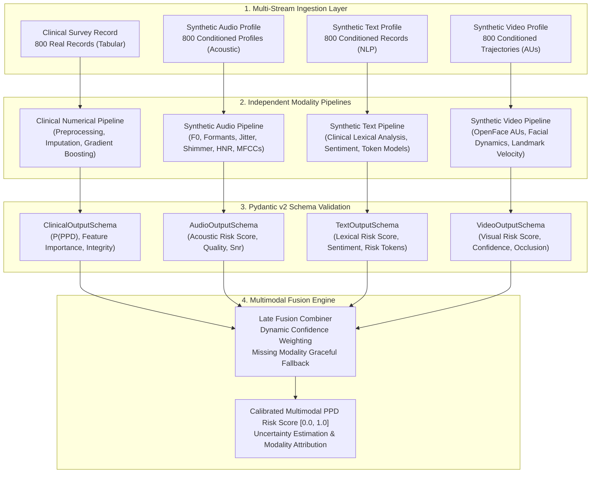

# Postpartum Depression (PPD) Recognition Research Prototype

[](https://github.com/navamishetty72/ppd-screening/actions)
[](https://www.python.org/)
[](https://fastapi.tiangolo.com/)
[](https://docs.pydantic.dev/)
[]()

A research-oriented, multimodal computational screening prototype for Postpartum Depression (PPD) combining real clinical survey data with clinically conditioned synthetic acoustic, linguistic, and visual feature representations.

> [!IMPORTANT]
> **Developer Team Handoff Guide:**  
> The data foundation phase is complete across all four branches (clinical numerical + synthetic audio, text, and video). For the incoming developer implementing unimodal model training, evaluation, and multimodal late fusion, please refer to the complete handoff specification at:  
> [**Developer Handoff Guide (docs/TEAM_HANDOFF.md)**](docs/TEAM_HANDOFF.md).

---

## 1. Project Overview & Research Objectives

Postpartum Depression (PPD) affects an estimated 10% to 20% of childbearing women globally, with elevated prevalence and chronic underdiagnosis across low- and middle-income countries (LMICs). Clinical screening has traditionally relied on self-report questionnaires such as the Edinburgh Postnatal Depression Scale (EPDS) and Patient Health Questionnaire (PHQ-9). While effective when administered by trained personnel, these psychometric instruments are susceptible to recall bias, social stigma, transcription variability, and regional access barriers.

Recent machine learning research has proposed multimodal computational architectures that integrate acoustic, visual, and lexical biomarkers to support psychiatric assessment. However, genuine multimodal clinical datasets—simultaneously capturing audio, video, text, and structured clinical observations from postpartum patients—do not currently exist in the open research domain.

This repository implements an **Architectural Integration Benchmark and Engineering Prototype** designed to:
- Establish a rigorous, leakage-free clinical baseline on verified postpartum survey data.
- Design a modular, decoupled four-branch multimodal architecture (`clinical_numerical`, `synthetic_audio`, `synthetic_text`, `synthetic_video`).
- Evaluate multimodal fusion mechanisms (early feature concatenation, late probability fusion, and hybrid cross-attention) under controlled simulated conditions.
- Implement robust integration contracts and defensive schema validation to prevent silent pipeline failures.

---

## 2. Research Boundaries & Ethical Considerations

> [!CAUTION]
> ### STRICT METHODOLOGICAL & CLINICAL DISCLAIMERS
> 1. **Research Prototype Only — Not for Clinical Diagnostic Use:** This system is an engineering research prototype designed to investigate multimodal fusion architectures and data integrity contracts. It has **NOT** undergone clinical trials, regulatory clearance, or clinical validation. It must **never** be used for medical diagnosis, clinical triage, or patient screening.
> 2. **Real Clinical Survey Data:** The clinical/numerical branch operates on 800 de-identified postpartum survey records collected in Bangladesh (canonical EPDS $\ge 13$ target; 351 positive, 449 negative). No identifying patient health information is retained or tracked in version control.
> 3. **Synthetic Modalities are Simulated Fixtures:** The Bangladeshi clinical dataset contains **zero** audio recordings, video sessions, or free-text narrative interviews. The acoustic, visual, and textual feature sets in this prototype are **simulated observations** generated from audited distributions and non-target clinical conditioning.
> 4. **Constructed Linkage for Architectural Benchmarking:** Synthetic records share participant identifiers with clinical records solely to test end-to-end data pipelines, multimodal tensor fusion, and defensive fallback contracts. This linkage is mathematically constructed; synthetic records do **not** represent real recordings or behavioral expressions of the surveyed women.
> 5. **No Synthetic Clinical Validity Claims:** Performance improvements observed on synthetic or semi-synthetic multimodal inputs evaluate pipeline robustness and fusion algorithms only. They **cannot and do not** demonstrate real-world clinical predictive efficacy.
> 6. **Zero Target Leakage:** EPDS questionnaire items (e.g., EPDS_1 through EPDS_10) and PHQ questions are strictly sequestered to derive ground truth labels and are excluded from clinical predictor sets and synthetic conditioning routines.

---

## 3. Four-Branch Multimodal Architecture

The prototype implements four independent modality pipelines converging into a late-fusion and decision layer:



### Modality Pipeline Specifications

| Branch | Data Source | Features / Representations | Primary Models |
|---|---|---|---|
| **`clinical_numerical`** | 800 real postpartum survey records | Sociodemographic, obstetric history, marital/family support, healthcare access (48 non-target predictors) | LightGBM, XGBoost, Calibrated Logistic Regression |
| **`synthetic_audio`** | 800 clinically conditioned simulations | Acoustic parameters: F0 mean/std, jitter, shimmer, HNR, formants (F1–F3), pause ratio, MFCCs | Random Forest, 1D-CNN, MLP |
| **`synthetic_text`** | 800 clinically conditioned simulations | Simulated clinical interview responses, postpartum sentiment tokens, semantic embeddings | Transformer-based embeddings, TF-IDF + Logistic Regression |
| **`synthetic_video`** | 800 clinically conditioned simulations | Facial Action Units (AU04, AU12, AU15), head pose dynamics, gaze velocity, smile duration | Temporal Convolutional Network (TCN), BiLSTM, SVM |

---

## 4. Repository Structure

```
PPD-Research/
│
├── README.md                      # Comprehensive project documentation
├── requirements.txt              # Core Python dependencies
├── .gitignore                    # Exclusion rules for private data, models, caches
├── .env.example                  # Environment configuration template
│
├── data/
│   ├── raw/                      # Raw dataset placeholders and ingestion manifests
│   ├── processed/                # Audited, cleaned, and partitioned feature matrices
│   └── synthetic/                # Clinically conditioned synthetic multimodal fixtures
│
├── pipelines/
│   ├── clinical_numerical/       # Pipeline 1: Real clinical survey modeling
│   ├── synthetic_audio/          # Pipeline 2: Acoustic feature extraction and modeling
│   ├── synthetic_text/           # Pipeline 3: Clinical narrative and lexical modeling
│   └── synthetic_video/          # Pipeline 4: Facial Action Unit and visual modeling
│
├── fusion/                       # Multimodal fusion engines (early, late, hybrid)
├── evaluation/                   # Evaluation protocols, benchmark metrics, validation
├── backend/                      # FastAPI asynchronous inference service
├── frontend/                     # Research dashboard and multimodal visualization UI
├── tests/                        # Comprehensive unit, integration, and contract test suite
│
├── research/
│   ├── literature_review/        # Systematic reviews of multimodal PPD and depression literature
│   ├── methodology/              # Formal scientific protocols and generation logic
│   ├── evidence_gaps/            # Gap analysis between published claims and empirical evidence
│   └── risk_register/            # Clinical, algorithmic, and methodological risk registers
│
└── docs/                         # System architecture specifications and API contracts
```

---

## 5. Technology Stack

- **Runtime & Language:** Python 3.11+
- **Machine Learning & Statistics:** `scikit-learn>=1.4.0`, `numpy>=1.26.0`, `pandas>=2.2.0`, `scipy>=1.12.0`
- **Data Validation & Typing:** `pydantic>=2.6.0`, `pydantic-settings>=2.2.0`
- **API & Serving:** `fastapi>=0.110.0`, `uvicorn[standard]>=0.28.0`
- **Testing & Quality Assurance:** `pytest>=8.0.0`, `pytest-cov>=4.1.0`
- **Acoustic & Vision Specifications:** Librosa-compatible schemas, OpenFace 2.2.0 AU definitions

---

## 6. Installation & Environment Configuration

### Prerequisites
- Python 3.11 or higher
- Git 2.30+
- Virtual environment tool (`venv` or `conda`)

### Step 1: Clone the Repository
```bash
git clone https://github.com/navamishetty72/ppd-screening.git
cd ppd-screening
```

### Step 2: Create and Activate Virtual Environment
```bash
# Windows (PowerShell)
python -m venv .venv
.venv\Scripts\Activate.ps1

# Linux / macOS
python3 -m venv .venv
source .venv/bin/activate
```

### Step 3: Install Dependencies
```bash
pip install --upgrade pip
pip install -r requirements.txt
```

### Step 4: Configure Environment Variables
```bash
# Copy template configuration
cp .env.example .env
```

Review `.env` and adjust configuration variables as needed:
```ini
ENVIRONMENT=development
RANDOM_SEED=42
LOG_LEVEL=INFO
API_HOST=0.0.0.0
API_PORT=8000
```

---

## 7. How to Run the Project

### Running the Test Suite
Verify that all schemas, pipeline contracts, and test fixtures pass:
```bash
pytest tests/ -v
```

### Starting the FastAPI Inference Server
Launch the backend service in development mode:
```bash
uvicorn backend.main:app --reload --host 0.0.0.0 --port 8000
```
Interactive API documentation will be accessible at:
- Swagger UI: `http://localhost:8000/docs`
- ReDoc: `http://localhost:8000/redoc`

### Inspecting Architecture Documentation
Detailed architectural blueprints, sequence diagrams, and mathematical formulation of the late fusion algorithm can be found in [`docs/architecture.md`](docs/architecture.md).

---

## 8. Data Governance & Security

- **Strict `.gitignore` Enforcement:** Real patient data, large auxiliary feature directories (`Audio_feature/`, `Video_feature/`), trained weights (`.joblib`, `.pt`, `.onnx`), and environment credentials (`.env`) are strictly excluded from version control.
- **Reproducible Partitioning:** All train/validation/test splits use fixed pseudo-random seeds (`seed=42`) with stratification on the canonical binary EPDS label ($\ge 13$).
- **No Secret Storage:** No passwords, access tokens, or sensitive endpoint configurations are committed to this repository.

---

## 9. Contributors & Research Citation

This prototype is developed for academic and computational research into multimodal psychiatric screening architectures.

If utilizing this repository structure or methodology in your research, please cite:
```bibtex
@misc{ppd_multimodal_prototype_2026,
  title={Postpartum Depression (PPD) Multimodal Recognition Research Prototype},
  author={Research Team},
  year={2026},
  publisher={GitHub},
  howpublished={\url{https://github.com/navamishetty72/ppd-screening}}
}
```

---

## 10. License

This repository is distributed under a **Research-Only License**. The code and schemas may be used for educational, scientific, and experimental evaluation purposes. Commercial exploitation, clinical diagnostic deployment, and unverified medical application are strictly prohibited.
