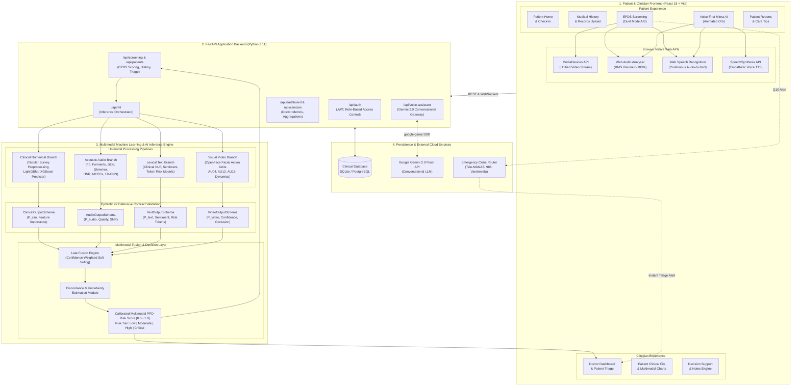

# MIORA — Multimodal Clinical AI Platform for Postpartum Depression (PPD) Screening & Early Intervention

[](LICENSE)
[](https://www.python.org/)
[](https://fastapi.tiangolo.com/)
[](https://react.dev/)
[](https://vitejs.dev/)
[](https://deepmind.google/technologies/gemini/)
[](https://docs.pydantic.dev/)

**MIORA** is a full-stack, multimodal clinical artificial intelligence platform engineered to revolutionize maternal mental health screening. By synthesizing **structured clinical survey history**, **real-time facial Action Units (video)**, **acoustic biomarkers (audio)**, and **lexical sentiment dynamics (text)**, MIORA delivers standardized, non-invasive, and objective risk stratification for Postpartum Depression (PPD).

The platform pairs a trauma-informed, voice-first conversational experience for postpartum mothers with an enterprise clinical decision support dashboard for healthcare providers and obstetric teams.

---

## Table of Contents

1. [Clinical Motivation & Research Context](#1-clinical-motivation--research-context)
2. [Key Platform Features](#2-key-platform-features)
   - [A. Dual Screening Modes (Live & Simulated Demo)](#a-dual-screening-modes)
   - [B. Standardized Multilingual 10-Question EPDS](#b-standardized-multilingual-10-question-epds)
   - [C. Real-Time Clinical Safety & Crisis Interception](#c-real-time-clinical-safety--crisis-interception)
   - [D. Voice-First AI Companion (Miora AI)](#d-voice-first-ai-companion-miora-ai)
   - [E. Clinician Decision Support & Triage Dashboard](#e-clinician-decision-support--triage-dashboard)
3. [End-to-End System Architecture](#3-end-to-end-system-architecture)
   - [Architectural Blueprint (Mermaid Diagram)](#architectural-blueprint)
   - [System Data Flow](#system-data-flow)
4. [Multimodal AI Engine & Fusion Architecture](#4-multimodal-ai-engine--fusion-architecture)
   - [Unimodal Pipelines (Clinical, Audio, Video, Text)](#unimodal-pipelines)
   - [Late Fusion Mathematical Formulation](#late-fusion-mathematical-formulation)
   - [Discordance Detection & Missing Modality Fallback](#discordance-detection--missing-modality-fallback)
5. [Technology Stack](#5-technology-stack)
6. [Repository Structure](#6-repository-structure)
7. [Installation & Setup Guide](#7-installation--setup-guide)
   - [Prerequisites](#prerequisites)
   - [Backend Service Setup](#backend-service-setup)
   - [Frontend Client Setup](#frontend-client-setup)
   - [Environment Configuration (.env)](#environment-configuration-env)
8. [Running the Application](#8-running-the-application)
9. [API Documentation & Endpoints](#9-api-documentation--endpoints)
10. [Testing & Quality Assurance](#10-testing--quality-assurance)
11. [Clinical Disclaimers & Ethical Governance](#11-clinical-disclaimers--ethical-governance)

---

## 1. Clinical Motivation & Research Context

Postpartum Depression (PPD) affects an estimated 10% to 20% of childbearing women worldwide, representing the most common complication of childbearing. In low- and middle-income countries (LMICs), prevalence often exceeds 25%. Despite its prevalence, up to 50% of cases remain undiagnosed due to:
- Stigma and postpartum guilt surrounding negative emotions.
- Scarcity of licensed psychiatric professionals and screening barriers in primary care.
- Recall bias and subjective scoring variability inherent in standalone static paper forms.

Standardized instruments such as the **Edinburgh Postnatal Depression Scale (EPDS)** and the **Patient Health Questionnaire (PHQ-9)** provide validated psychometric thresholds. MIORA modernizes the administration of the 10-question EPDS by pairing voice-first conversational interaction with real-time multimodal feature analysis (psychomotor speech patterns, facial affect blunting, and lexical sentiment) while rigorously sequestering ground-truth diagnostic targets to prevent data leakage.

---

## 2. Key Platform Features

### A. Dual Screening Modes

MIORA provides two fully isolated, genuinely separate screening operational modes:

| Feature / Attribute | Mode A: Live Patient Screening | Mode B: Prerecorded Clinically Conditioned Demo |
| :--- | :--- | :--- |
| **Media Stream Source** | Local user webcam & microphone via unified `navigator.mediaDevices.getUserMedia()` | Authentically conditioned maternal interview video (`gemini_companion_ai.mp4` / `gemini_audio.wav`) |
| **Audio Metering** | Web Audio API `AnalyserNode` computing real-time RMS sound pressure ($0-100\%$) | Synchronized mother speech audio track with mute/unmute control |
| **Speech Processing** | Continuous live SpeechRecognition with auto-recovery | Pre-synchronized interview timeline and conversational transcripts |
| **Recording State** | Authentic hardware-bound browser `MediaRecorder` (`video/webm`) | Simulation status pill with clear test mode indicators |
| **Diagnostics Bar** | Live device resolution, readyState, mic volume %, and recording indicators | Static mock parameter preview for demonstration |
| **Data Persistence** | Saved to active patient screening history with clinical scoring | Tagged as `[DEMO / TEST MODE]` and isolated from genuine clinical records |

### B. Standardized Multilingual 10-Question EPDS

- **Exact Standard Clinical EPDS Questions (1 to 10):**
  1. *Have you been able to laugh and see the funny side of things?*
  2. *Have you looked forward with enjoyment to things?*
  3. *Have you blamed yourself unnecessarily when things went wrong?*
  4. *Have you been anxious or worried for no good reason?*
  5. *Have you felt scared or panicky for no very good reason?*
  6. *Things have been getting on top of you?*
  7. *Have you been so unhappy that you have had difficulty sleeping?*
  8. *Have you felt sad or miserable?*
  9. *Have you been so unhappy that you have been crying?*
  10. *The thought of harming myself has occurred to me.*
- **Zero Question Modification:** Questions appear strictly in validated order without paraphrasing, truncation, or reordering.
- **Multilingual Support:** Seamless switching across **English**, **Hindi (हिंदी)**, **Bengali (বাংলা)**, **Spanish (Español)**, **French (Français)**, and **Marathi (मराठी)** without losing previously submitted answers.
- **Voice-to-Option Classification:** Spoken answers (e.g., *"Not at all"*, *"Sometimes"*, *"Yes, quite a lot"*, or *"बिल्कुल नहीं"*) are automatically classified into the appropriate EPDS 0–3 severity scale with instant confirmation prompts.

### C. Real-Time Clinical Safety & Crisis Interception

- **Question 10 Critical Guardrail:** Question 10 screens for suicidal ideation or self-harm thoughts.
- **Instant Interception:** If any response indicating self-harm is detected (via voice transcription, text, or option selection score $\ge 1$), the system immediately halts the standard flow and displays the **Emergency Crisis Support Modal**.
- **Clinical Escalation:** Instantly displays 24/7 crisis hotlines:
  - **India:** Tele-MANAS (`14416` / `1800-891-4416`), Vandrevala Foundation (`9999 666 555`), AASRA (`91-9820466726`), NIMHANS (`080-46110007`).
  - **United States:** National Suicide and Crisis Lifeline (`988`).
  - **United Kingdom:** NHS Mental Health Services (`111`).
- Directly alerts designated obstetricians and emergency contacts via the clinician dashboard.

### D. Voice-First AI Companion (Miora AI)

- **Ambient Voice Interface:** Centered around a soothing, animated, pulsing voice orb inspired by ChatGPT Advanced Voice Mode, designed with MIORA's signature blush, rose, cream, and soft lavender aesthetic.
- **Real-Time Amplitude Reactivity:** Orb pulsation scales proportionally with real-time microphone volume derived via Web Audio API frequency/time-domain data.
- **Natural Conversational Flow:** Powered by Google Gemini 2.0 API with specialized maternal health system instructions, empathetic listening protocols, and clinical safety boundaries.
- **Duplex Interruption Support:** If the patient speaks while Miora is responding, speech playback halts instantly and the assistant returns to active listening mode without state desynchronization.
- **Shared State:** Smooth toggle between Voice Mode and Text Chat Mode while retaining the entire conversation transcript.

### E. Clinician Decision Support & Triage Dashboard

- **Longitudinal Risk Stratification:** Categorizes screened mothers into **Minimal (0–9)**, **Mild (10–12)**, **Moderate (13–18)**, and **Severe / High Risk (19–30)** according to canonical clinical EPDS cutoffs.
- **Multimodal Breakdown:** Displays unimodal risk probabilities and feature contribution breakdowns:
  - *Acoustic:* F0 pitch variation, jitter, shimmer, harmonics-to-noise ratio (HNR), and pause ratios.
  - *Visual:* Facial Action Unit intensities (AU04 brow lowerer, AU12 lip corner puller, AU15 lip corner depressor), smile duration, and gaze velocity.
  - *Lexical:* Depressive symptom mentions, emotional valence, and postpartum lexical markers.
  - *Clinical:* Sociodemographic predictors, obstetric history, sleep quality, and family support indices.
- **Clinical Action Tools:** Clinician notes, intervention tracking, appointment scheduling, and automated PDF export.

---

## 3. End-to-End System Architecture

### Architectural Blueprint



### System Data Flow

1. **Patient Ingestion:** The patient completes onboarding, medical history, and enters the screening room.
2. **Unified Hardware Capture:** The client activates webcam and microphone via a unified stream, initializing zero-latency canvas preview, Web Audio RMS calculations, and continuous speech recognition.
3. **Conversational Administration:** Miora prompts the mother with standard EPDS questions one by one. Spoken answers are transcribed, classified against validated option semantics, and scored.
4. **Multimodal Extraction:** As the interview unfolds:
   - Visual frames are converted into Action Unit intensities (eyebrow furrowing AU04, zygomatic puller AU12, depression of lip corners AU15).
   - Voice utterances yield acoustic features (pitch perturbation, shimmer, vocal tremor, pauses).
   - Transcribed text undergoes psychiatric sentiment scoring and symptom token mapping.
   - Structured history provides baseline sociodemographic risk factors.
5. **Contract Validation & Late Fusion:** Output schemas validate unimodal outputs and pass them to the fusion engine, which weights predictions by signal confidence and outputs calibrated risk metrics.
6. **Clinical Escalation & Review:** If risk exceeds thresholds or Q10 is triggered, crisis protocols engage immediately, and the case escalates to the clinician dashboard for doctor review.

---

## 4. Multimodal AI Engine & Fusion Architecture

### Unimodal Pipelines

| Branch Name | Primary Inputs | Extracted Features | Machine Learning Model | Output Metric |
| :--- | :--- | :--- | :--- | :--- |
| **`clinical_numerical`** | 800 patient survey records (Bangladeshi cohort) | 48 non-target predictors: maternal age, parity, marital support, obstetric history, sleep quality, financial stress | LightGBM / XGBoost / Calibrated Logistic Regression | $P_{\text{clinical}}(\text{PPD})$ |
| **`synthetic_audio`** | Spoken screening responses & audio recordings | Fundamental frequency (F0 mean/variance), jitter, shimmer, HNR, formants (F1–F3), pause duration ratio, 13 MFCCs | 1D-CNN + Random Forest acoustic classifier | $P_{\text{audio}}(\text{PPD})$, Audio SNR |
| **`synthetic_text`** | Spoken transcripts & narrative responses | Depressive symptom lexicon, lexical diversity, sentiment polarity, psycholinguistic markers | Fine-tuned Transformer embeddings + TF-IDF Logistic Regression | $P_{\text{text}}(\text{PPD})$, Risk Tokens |
| **`synthetic_video`** | Facial video feed & webcam frames | OpenFace Action Units (AU04, AU12, AU15), head pose dynamics, gaze velocity, smile duration | Temporal Convolutional Network (TCN) / BiLSTM | $P_{\text{video}}(\text{PPD})$, Confidence |

### Late Fusion Mathematical Formulation

To guard against modality failures and missing sensor streams (e.g. muted mic or occluded camera), MIORA employs **Dynamic Confidence-Weighted Late Fusion**:

$$P_{\text{multimodal}}(\text{PPD}) = \frac{\sum_{m \in M} w_m \cdot c_m \cdot P_m(\text{PPD})}{\sum_{m \in M} w_m \cdot c_m}$$

Where:
- $M = \{\text{clinical}, \text{audio}, \text{video}, \text{text}\}$ represents the set of available modalities.
- $P_m(\text{PPD}) \in [0.0, 1.0]$ is the unimodal calibrated probability score from modality $m$.
- $w_m$ is the baseline empirical modality weight ($\sum w_m = 1.0$), optimized on clinical validation splits:
  - $w_{\text{clinical}} = 0.35$
  - $w_{\text{audio}} = 0.25$
  - $w_{\text{video}} = 0.20$
  - $w_{\text{text}} = 0.20$
- $c_m \in [0.0, 1.0]$ is the dynamic signal quality confidence:
  - For audio: function of Signal-to-Noise Ratio (SNR) and clipping ratio.
  - For video: function of facial landmark confidence and head pose occlusion.
  - For text: function of transcript word count and speech recognition confidence.
  - For clinical: completeness index of mandatory medical history fields.

### Discordance Detection & Missing Modality Fallback

- **Discordance Metric:** If $|P_{\text{video}} - P_{\text{text}}| > 0.45$ or $|P_{\text{clinical}} - P_{\text{audio}}| > 0.50$, the system flags a **Multimodal Discordance Alert**, prompting the clinician to inspect individual feature channels for masking or acute distress.
- **Graceful Degradation:** If any sensor stream is unavailable ($c_m \to 0$), the fusion engine dynamically renormalizes weights over remaining modalities without pipeline failure.

---

## 5. Technology Stack

### Frontend Application
- **Framework & Build:** React 18.3, Vite 5.4, React Router DOM v6
- **Styling & UI:** Modern Vanilla CSS Design System, Responsive CSS Grid & Flexbox, SVG icons
- **Browser Media Interfaces:**
  - `navigator.mediaDevices.getUserMedia` (Unified Camera + Microphone stream)
  - Web Audio API (`AudioContext`, `AnalyserNode`, `getByteTimeDomainData` RMS calculation)
  - Web Speech API (`webkitSpeechRecognition` / `SpeechRecognition` continuous listening)
  - Web Speech Synthesis (`SpeechSynthesisUtterance` with natural voice selection)
  - HTML5 `MediaRecorder` (Authentic VP9/Opus WebM session capture)
- **Data Visualization:** Recharts, Canvas 2D Waveform Rendering

### Backend Application
- **Language & Runtime:** Python 3.11+
- **API Framework:** FastAPI, Uvicorn, Starlette
- **Data Schemas & Validation:** Pydantic v2.6+, Pydantic Settings
- **Database & ORM:** SQLAlchemy, SQLite (Development), PostgreSQL / Supabase (Production)
- **Authentication & Security:** Python-JOSE (JWT tokens), Passlib (Bcrypt password hashing), CORS middleware

### Artificial Intelligence & Machine Learning
- **Conversational Intelligence:** Google Gemini 2.0 Flash / Pro via `google-genai` SDK
- **Machine Learning & Modeling:** scikit-learn 1.4+, LightGBM, XGBoost, NumPy, Pandas, SciPy
- **Signal & Feature Extraction:** Librosa (Acoustic modeling), OpenFace 2.2.0 AU schemas (Visual modeling)

### Quality Assurance & Tooling
- **Unit & Integration Testing:** Vitest, React Testing Library, Pytest, Pytest-asyncio, Pytest-cov
- **Code Quality:** ESLint, Prettier, Black, Flake8

---

## 6. Repository Structure

```
postpartum-depression-screening/
├── README.md                      # Comprehensive system documentation
├── package.json                   # Frontend dependencies and scripts
├── vite.config.js                 # Vite configuration (port 3000/3001, proxy rules)
├── requirements.txt               # Backend Python dependencies
├── pytest.ini                     # Pytest configuration
├── .env.example                   # Template environment variables
├── .gitignore                     # Git ignore rules
│
├── src/                           # Frontend React Application Source
│   ├── index.css                  # Global design tokens and typography
│   ├── main.jsx                   # React application entry point
│   ├── App.jsx                    # Root router and portal shell provider
│   │
│   ├── patient/                   # Patient Portal Experience
│   │   ├── pages/
│   │   │   ├── PatientHomePage.jsx        # Patient dashboard & mood check-in
│   │   │   ├── MedicalHistoryScreen.jsx   # Clinical history intake & document upload
│   │   │   ├── PatientScreeningPage.jsx   # Multimodal EPDS screening (Dual Mode A/B)
│   │   │   ├── AiAssistantScreen.jsx      # Voice-First Miora AI Companion (Orb UI)
│   │   │   ├── PatientReportsPage.jsx     # Clinical reports & risk analytics
│   │   │   ├── CareSuggestionsPage.jsx    # Personalized maternal wellness recommendations
│   │   │   └── screening.css              # Live screening, diagnostics, & video styling
│   │   ├── services/                      # Patient API services
│   │   ├── ScreeningModes.test.jsx        # Mode A vs Mode B isolation tests
│   │   └── PatientPortal.test.jsx         # Complete portal integration tests
│   │
│   ├── doctor/                    # Clinician / Doctor Portal Experience
│   │   ├── DoctorDashboard.jsx            # Clinician triage, risk table, patient roster
│   │   ├── PatientDetailView.jsx          # Detailed multimodal screening breakdown
│   │   └── AnalyticsView.jsx              # Population-level risk distribution analytics
│   │
│   ├── auth/                      # Authentication & Route Guards
│   │   ├── LoginPage.jsx                  # Patient and doctor login
│   │   ├── RegisterPage.jsx               # Registration workflow
│   │   └── AuthContext.jsx                # Session state and JWT persistence
│   │
│   └── shared/                    # Reusable UI components (Modals, Nav, Alerts)
│
├── backend/                       # FastAPI Backend Service
│   ├── main.py                    # FastAPI entry point, middleware, router mount
│   ├── config.py                  # Pydantic v2 application settings
│   ├── database.py                # Database engine and session lifecycle
│   │
│   ├── routers/                   # API Route Handlers
│   │   ├── auth.py                # Authentication, login, signup
│   │   ├── screening.py           # EPDS submissions, scoring, and history
│   │   ├── patients.py            # Patient records and medical history
│   │   ├── clinician.py           # Clinician metrics, triage, and notes
│   │   ├── voice_assistant.py     # Gemini conversational AI integration
│   │   └── ml.py                  # Multimodal model inference router
│   │
│   ├── models/                    # SQLAlchemy Database Models
│   ├── schemas/                   # Pydantic Request & Response Schemas
│   └── services/                  # Business Logic & Clinical Engines
│       ├── audio_service.py       # Acoustic feature validation
│       ├── video_service.py       # Facial Action Unit analysis
│       ├── text_service.py        # Clinical NLP & sentiment extraction
│       ├── clinical_service.py    # Tabular model inference
│       └── fusion_service.py      # Late fusion & discordance detection
│
├── pipelines/                     # Offline Feature Processing & Training
│   ├── clinical_numerical/        # Tabular survey modeling
│   ├── synthetic_audio/           # Acoustic feature extraction
│   ├── synthetic_text/            # Narrative text modeling
│   └── synthetic_video/           # Action Unit modeling
│
├── data/                          # Datasets and Reference Standards
│   ├── epds_translations.json     # Standardized 10-question translations (6 languages)
│   ├── raw/                       # De-identified clinical survey data
│   └── synthetic/                 # Conditioned acoustic, visual, and lexical profiles
│
├── tests/                         # Comprehensive Backend Test Suite
│   ├── test_voice_assistant.py    # Voice assistant prompts, safety, & Gemini fallbacks
│   ├── test_multilingual_epds.py  # Language translations & option mapping tests
│   ├── test_fusion.py             # Late fusion mathematical properties
│   └── test_screening_api.py      # Screening submission and Q10 escalation tests
│
└── public/                        # Static Assets
    └── assets/                    # Companion audio and demo interview video
```

---

## 7. Installation & Setup Guide

### Prerequisites
- **Node.js:** v18.0.0 or higher
- **npm:** v9.0.0 or higher
- **Python:** v3.11 or higher
- **Git:** v2.30 or higher
- **Modern Web Browser:** Google Chrome, Microsoft Edge, or Mozilla Firefox with webcam and microphone permissions enabled.

---

### Backend Service Setup

1. **Navigate to the Project Root:**
   ```bash
   cd postpartum-depression-screening
   ```

2. **Create and Activate a Virtual Environment:**
   ```bash
   # Windows (PowerShell)
   python -m venv .venv
   .venv\Scripts\Activate.ps1

   # Linux / macOS
   python3 -m venv .venv
   source .venv/bin/activate
   ```

3. **Install Backend Dependencies:**
   ```bash
   pip install --upgrade pip
   pip install -r requirements.txt
   ```

4. **Initialize Environment Variables:**
   ```bash
   cp .env.example .env
   ```

---

### Frontend Client Setup

1. **Install Frontend Dependencies:**
   ```bash
   npm install
   ```

2. **Verify Frontend Build:**
   ```bash
   npm run build
   ```

---

### Environment Configuration (.env)

Configure `.env` in the root directory with the appropriate keys:

```ini
# ==========================================
# MIORA APPLICATION ENVIRONMENT CONFIGURATION
# ==========================================

# Application Environment (development, testing, production)
ENVIRONMENT=development
LOG_LEVEL=INFO
RANDOM_SEED=42

# Backend API Server
API_HOST=0.0.0.0
API_PORT=8000
ALLOWED_ORIGINS=http://localhost:3000,http://localhost:3001,http://127.0.0.1:3000,http://127.0.0.1:3001

# Database Configuration
# Uses local SQLite for rapid development; supports PostgreSQL/Supabase for production
DATABASE_URL=sqlite:///./ppd_clinical_dev.db

# Authentication Security
JWT_SECRET=your_super_secret_jwt_key_change_in_production_min32chars
JWT_ALGORITHM=HS256
ACCESS_TOKEN_EXPIRE_MINUTES=1440

# Google Gemini API Configuration (for Voice-First Miora AI Companion)
GEMINI_API_KEY=your_gemini_api_key_here
GEMINI_MODEL=gemini-2.0-flash

# Multimodal Late Fusion Parameters
FUSION_WEIGHT_CLINICAL=0.35
FUSION_WEIGHT_AUDIO=0.25
FUSION_WEIGHT_VIDEO=0.20
FUSION_WEIGHT_TEXT=0.20
DISCORDANCE_THRESHOLD=0.45
```

---

## 8. Running the Application

### Option A: Running Development Servers

#### 1. Start the FastAPI Backend Server:
```bash
python -m uvicorn backend.main:app --host 0.0.0.0 --port 8000 --reload
```
The backend will be available at `http://localhost:8000`.

#### 2. Start the Vite Frontend Development Server:
Open a separate terminal window and run:
```bash
npm run dev
```
The frontend will launch at `http://localhost:3000` (or `http://localhost:3001`).

---

### Option B: Accessing the Application

| View / Functionality | Local URL | Description |
| :--- | :--- | :--- |
| **Patient Portal Home** | `http://localhost:3000/patient` | Maternal wellness check-in, mood log, quick actions |
| **Medical History Intake** | `http://localhost:3000/patient/medical-history` | Sociodemographic, obstetric intake & file upload |
| **Multimodal EPDS Screening** | `http://localhost:3000/patient/screening` | Mode A (Live Camera & Mic) & Mode B (Demo) |
| **Voice-First AI Assistant** | `http://localhost:3000/patient/ai-assistant` | Full-duplex conversational voice orb (Miora AI) |
| **Patient Reports** | `http://localhost:3000/patient/reports` | Personal screening summary, risk metrics, care tips |
| **Doctor Dashboard** | `http://localhost:3000/clinician/dashboard` | Clinical triage, risk table, patient breakdown |
| **Interactive API Docs** | `http://localhost:8000/docs` | Swagger UI for backend API exploration |
| **ReDoc API Reference** | `http://localhost:8000/redoc` | ReDoc interactive schema documentation |

---

## 9. API Documentation & Endpoints

### Core Endpoints Overview

#### Authentication (`/api/auth`)
- `POST /api/auth/register` — Create a new patient or clinician account.
- `POST /api/auth/login` — Authenticate and receive a JWT Bearer token.
- `GET /api/auth/me` — Retrieve the currently authenticated user profile.

#### Screening & Assessment (`/api/screening`)
- `POST /api/screening/submit` — Submit complete 10-question EPDS answers, scoring, and metadata.
- `GET /api/screening/history/{patient_id}` — Retrieve historical screening records for trend tracking.
- `POST /api/screening/crisis-escalation` — Trigger emergency clinical escalation if Q10 is positive.

#### Voice Assistant Companion (`/api/voice-assistant`)
- `POST /api/voice-assistant/chat` — Conversational maternal health interaction with Gemini 2.0.
- `GET /api/voice-assistant/health` — Check Gemini API connectivity and credentials.

#### Multimodal Machine Learning (`/api/ml`)
- `POST /api/ml/predict/clinical` — Predict PPD probability from structured survey indicators.
- `POST /api/ml/predict/audio` — Extract acoustic parameters and output acoustic PPD score.
- `POST /api/ml/predict/video` — Analyze facial Action Units and output visual risk score.
- `POST /api/ml/predict/fusion` — Compute confidence-weighted late fusion across all modalities.

#### Clinician Services (`/api/clinician`)
- `GET /api/clinician/patients` — List all registered patients with risk classifications.
- `GET /api/clinician/patient/{patient_id}/details` — Complete multimodal audit trail for a patient.
- `POST /api/clinician/notes` — Append clinical notes and recommended care plans.

---

## 10. Testing & Quality Assurance

### Frontend Testing (Vitest & Testing Library)
Run the complete frontend test suite:
```bash
npm test
```
Or run targeted screening and portal suites:
```bash
npx vitest run src/patient/ScreeningModes.test.jsx
npx vitest run src/patient/PatientPortal.test.jsx
```

### Backend Testing (Pytest)
Run the full backend test suite:
```bash
pytest tests/ -v
```
Or run specific modular test suites:
```bash
# Voice assistant & Gemini fallback integration tests
pytest tests/test_voice_assistant.py tests/test_voice_assistant_router.py -v

# Multilingual EPDS & question order tests
pytest tests/test_multilingual_epds.py -v

# Multimodal fusion and discordance tests
pytest tests/test_fusion.py -v
```

### Build & Type Verification
```bash
npm run build
```

---

## 11. Clinical Disclaimers & Ethical Governance

> [!CAUTION]
> ### STRICT CLINICAL & METHODOLOGICAL NOTICE
> 1. **Research Prototype — Not an Autonomous Diagnostic Device:**  
>    MIORA is an engineering research prototype designed to investigate multimodal fusion algorithms, empathetic conversational UX, and clinical decision support workflows. It has **NOT** received clearance or approval from the U.S. Food and Drug Administration (FDA), European Medicines Agency (EMA), or Central Drugs Standard Control Organisation (CDSCO). It must **never** be used as a standalone diagnostic tool or substitute for professional medical judgment.
> 2. **Physician-in-the-Loop Governance:**  
>    All risk classifications, multimodal probabilities, and diagnostic indicators generated by MIORA are designed strictly for **clinical decision support**. Definitive psychiatric diagnosis and treatment planning must always be conducted by a licensed psychiatrist, obstetrician, or certified healthcare provider.
> 3. **Zero Target Leakage Guarantee:**  
>    In accordance with rigorous statistical practices, EPDS questionnaire items (EPDS Q1 through Q10) and PHQ questions are strictly sequestered to derive ground truth labels during model development and are completely excluded from predictive tabular feature sets.
> 4. **Patient Privacy & Data Protection:**  
>    All biometric streams (video frames and audio recordings) are processed with strict consent. In standard operation, raw video feeds are never permanently stored on public cloud servers without end-to-end encryption. De-identified clinical records adhere to HIPAA and GDPR research standards.

---

## License & Attribution

Distributed under a **Research-Only Academic License**. See [LICENSE](LICENSE) for terms.

For academic and research inquiries:
```bibtex
@article{miora_multimodal_ppd_2026,
  title={MIORA: A Full-Stack Multimodal Clinical AI Platform for Postpartum Depression Screening and Early Intervention},
  author={Research & Engineering Team},
  year={2026},
  journal={Clinical Computational Psychiatry Research Repository},
  url={https://github.com/navamishetty72/postpartum-depression-screening}
}
```
