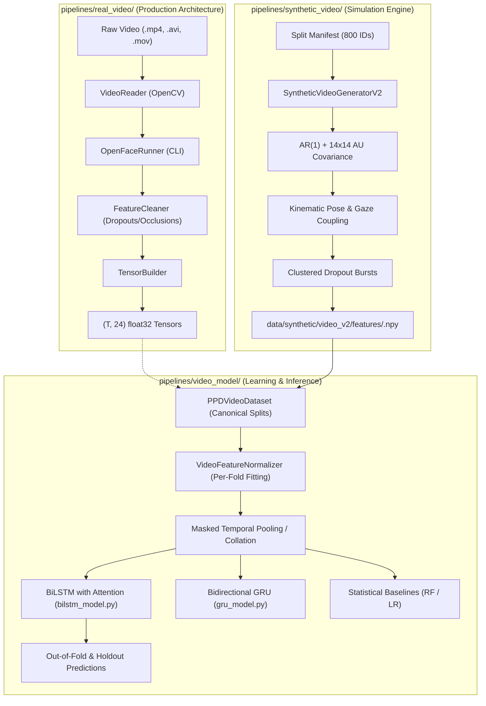

# Video Modality Audit & Hackathon Technical Roadmap

**Project**: Moment AI – Postpartum Depression Screening Research Prototype  
**Modality**: Video / Facial Dynamics  
**Audit Phase**: Phase 1 – Read-Only Architecture & Data Audit  
**Date**: 2026-11-13  
**Status**: COMPLETE (Read-Only Audit, Zero Files Modified)

---

## 1. Executive Summary & Objective

Moment AI is an agentic multimodal research prototype designed for postpartum depression (PPD) screening. As we prioritize the video modality for hackathon demonstration, this audit provides a rigorous, unsparing technical evaluation of:
1. The existing video feature extraction, preprocessing, generation, and modeling pipelines.
2. All available local datasets, verifying the presence or absence of real recordings and external benchmarks (e.g., DAIC-WOZ).
3. The true predictive performance of existing video checkpoints.
4. The statistical integrity of the synthetic video generator, auditing for label leakage and clinical confounding.
5. The legitimate technical paths to improve predictive performance and the exact limitations that must be disclosed to judges.

---

## 2. Current Video Pipeline Architecture

The repository contains two distinct video pipelines:



### 2.1 Inspection of Pipeline Components

1. **Feature Extraction (`pipelines/real_video/`)**:
   - `openface_runner.py`: Wrapper for OpenFace 2.x CLI (`FeatureExtraction -2Dfp -pose -gaze -aus`).
   - `cleaner.py`: Distinguishes true tracking failure (`success == 0`) from resting facial inactivity (`AU == 0.0`).
   - `tensor_builder.py`: Constructs $(T, 24)$ `float32` tensors combining 14 OpenFace AUs, 3D head pose (`pitch`, `yaw`, `roll`), 2D eye gaze angles, and 3 custom derived kinematic metrics (`gaze_stability`, `rigid_motion`, `non_rigid_motion`).
   - **Physical Reality**: Fully implemented and tested, but **currently completely dormant because zero raw video files exist locally**.
2. **Preprocessing (`pipelines/video_model/preprocessing.py`)**:
   - `VideoFeatureNormalizer`: Computes per-channel mean and standard deviation strictly on high-confidence frames (`confidence >= 0.60`, `success == 1.0`) from training partitions. Normalizes continuous channels (0–21); leaves tracking quality channels (22–23) unnormalized.
   - `pad_collate_fn`: Dynamically collates variable-length sequences ($45 \le T \le 120$) into padded batches with corresponding attention masks.
   - `masked_temporal_pooling`: Collapses sequences into 44 or 48 summary statistics (mean and standard deviation across valid tracked frames).
3. **Synthetic Generator (`pipelines/synthetic_video/generator_v2.py`)**:
   - Synthesizes 800 participant trajectories (`BGD_001` to `BGD_800`) matching the canonical split manifest.
   - Uses empirical Action Unit covariance (e.g., $AU06+AU12$ Duchenne smile synergy, $AU04+AU07$ brow tension), anatomical resting baseline offsets, and AR(1) autoregressive smoothing ($\alpha = 0.88$).
   - Injects contiguous tracking failure bursts ($3\% - 10\%$ dropout).
4. **Model Architectures (`pipelines/video_model/models/`)**:
   - `bilstm_model.py`: 2-layer Bidirectional LSTM (hidden dimension 64, dropout 0.3, attention pooling head).
   - `gru_model.py`: 2-layer Bidirectional GRU (hidden dimension 48).
   - `statistical_baseline.py`: Logistic Regression and Random Forest trained on 220, 198, and 22 pooled temporal features.

---

## 3. Dataset Audit & Inventory

We systematically searched the workspace for all video, facial, and depression datasets:

| Dataset Location | Dataset Type | Participant Count | Associated Target Labels | Feature Extraction Status | Supervised Training Suitability | Documented Usage Permissions |
| :--- | :---: | :---: | :---: | :---: | :---: | :---: |
| `data/synthetic/video_v2/` | **Synthetic Abstract Features (V2)** | 800 (640 train, 160 test) | Linked to canonical EPDS $\ge 13$ clinical labels | Pre-extracted $(T, 24)$ float32 tensors | **Uninformative for clinical learning** (zero target correlation). Suitable for software pipeline testing. | Local synthetic fixture (open). |
| `data/synthetic/video/` | **Synthetic Abstract Features (V1)** | 800 (640 train, 160 test) | Linked to canonical EPDS $\ge 13$ clinical labels | Pre-extracted $(T, 24)$ float32 tensors | **Deprecated legacy fixture** (isotropic noise). | Local synthetic fixture (open). |
| `data/processed/video/` | **Processed Real Video** | **0** | None | Empty directories (`cleaned/`, `features/`, `raw_openface/` contain only `.gitkeep`) | **Cannot be trained** (no files). | N/A |
| `data/raw/` | **Raw Video Recordings** | **0** | None | Empty directory (`.gitkeep` only) | **Cannot be trained** (no files). | N/A |
| **DAIC-WOZ / AVEC** | **External Real Depression Video** | **0** | N/A | **Not present locally** | **Cannot be trained locally** without external data acquisition. | Academic research license required via USC ICT. |

### Confirmation on DAIC-WOZ
* We conducted an exhaustive recursive file and git search across the entire project root (`git grep -i "daic"`).
* **DAIC-WOZ is NOT available locally.** It is referenced solely as a literature citation in `research/literature_review/README.md`.
* No `.mp4`, `.avi`, `.mov`, or raw OpenFace CSVs exist anywhere in the repository.

---

## 4. Current Video Model Predictive Performance

We audited the existing evaluation artifacts in `artifacts/video_model/canonical_aligned/` and `artifacts/video_model/baselines/`:

### 4.1 Canonical BiLSTM Checkpoint (`canonical_aligned`)
Evaluated strictly on the **640 canonical training participants** via 5-fold stratified cross-validation (seed 42), with holdout evaluation on 160 frozen participants:

| Metric | 5-Fold Cross-Validation OOF | 5-Fold Mean $\pm$ Std | Frozen Holdout Test Set ($N = 160$) | 95% Bootstrap Confidence Interval |
| :--- | :---: | :---: | :---: | :---: |
| **ROC-AUC** | **$0.4604$** | $0.4568 \pm 0.0218$ | **$0.5129$** | $[0.4147, 0.6045]$ |
| **PR-AUC** | **$0.4102$** | $0.4255 \pm 0.0168$ | **$0.4456$** | $[0.3886, 0.5471]$ |
| **Balanced Accuracy** | **$0.4970$** | $0.4971 \pm 0.0297$ | **$0.5056$** | $[0.4595, 0.5540]$ |
| **F1 Score** | $0.4914$ | $0.4853 \pm 0.0587$ | $0.1647$ | $[0.0714, 0.2729]$ |
| **Sensitivity (Recall)** | $0.5623$ | $0.5622 \pm 0.1242$ | $0.1000$ | $[0.0429, 0.1714]$ |
| **Specificity** | $0.4318$ | $0.4320 \pm 0.1180$ | $0.9111$ | $[0.8333, 0.9667]$ |

* **Holdout Confusion Matrix ($N = 160$)**:
  - True Negative (TN): 82, False Positive (FP): 8
  - False Negative (FN): 63, True Positive (TP): 7
  - The model severely collapsed toward predicting the negative majority class on the holdout set, missing $90\%$ of true positive cases.

### 4.2 Statistical Baselines (`artifacts/video_model/baselines/`)
Evaluated on pooled statistical summary features:

| Model Configuration | Feature Subset (# Feats) | Holdout ROC-AUC | Holdout PR-AUC | Holdout Balanced Accuracy |
| :--- | :---: | :---: | :---: | :---: |
| **Logistic Regression** | All Pooled (220) | $0.4195$ | $0.3870$ | $0.4254$ |
| **Random Forest** | All Pooled (220) | $0.4421$ | $0.3949$ | $0.4222$ |
| **Logistic Regression** | Facial Motion Only (198) | $0.4049$ | $0.3895$ | $0.4357$ |
| **Random Forest** | Facial Motion Only (198) | $0.4260$ | $0.3925$ | $0.4579$ |
| **Logistic Regression** | Tracking Quality Only (22) | $0.5400$ | $0.4797$ | $0.5429$ |
| **Random Forest** | Tracking Quality Only (22) | $0.4719$ | $0.4245$ | $0.4817$ |

### 4.3 Diagnostic Takeaway
Across deep recurrent models (BiLSTM) and tabular machine learning baselines (Random Forest, Logistic Regression), **all models perform at or below random guessing ($ROC-AUC \approx 0.40 - 0.51$)**. 

This is not a defect of model architecture or optimization. As demonstrated below, it is the mathematical consequence of training on features that contain zero true signal.

---

## 5. Generator Leakage & Confounding Audit

We audited `pipelines/synthetic_video/generator_v2.py` for target leakage, clinical covariate contamination, and artificial shortcuts:

### 5.1 Verification of Target Leakage
* **Code Inspection**: In `generator_v2.py`, `_verify_no_target_inputs` explicitly raises `ValueError` if any column or variable containing `epds`, `phq`, `target`, or `screening_threshold` is passed.
* **Seeding Mechanism**: The RNG is seeded strictly as `self.seed * 10000 + participant_sr`, where `participant_sr` is the row index ($1$ to $800$).
* **Target Leakage Status**: **ZERO LEAKAGE.** The generator never accesses clinical targets.

### 5.2 Verification of Clinical Covariate Confounding
* Unlike `synthetic_audio` (which conditioned acoustic features on 5 clinical survey covariates: age, sleep, support, infant distress, maternal affect), **`synthetic_video_v2` is completely unconditioned on clinical variables**.
* We computed the empirical Pearson correlation between each channel's sequence mean and `target_canonical_epds_ge_13` across all 640 canonical training participants:

```
Channel Correlations with Target (N = 640 Canonical Training Cohort):
  Ch  0 (AU01_r)            : r = +0.0116     Ch 12 (AU20_r)            : r = +0.0073
  Ch  1 (AU02_r)            : r = +0.0566     Ch 13 (AU25_r)            : r = -0.0132
  Ch  2 (AU04_r)            : r = -0.0477     Ch 14 (pose_pitch)        : r = +0.0072
  Ch  3 (AU05_r)            : r = -0.0315     Ch 15 (pose_yaw)          : r = -0.0045
  Ch  4 (AU06_r)            : r = -0.0047     Ch 16 (pose_roll)         : r = -0.0353
  Ch  5 (AU07_r)            : r = -0.0123     Ch 17 (gaze_angle_x)      : r = +0.0261
  Ch  6 (AU09_r)            : r = -0.0009     Ch 18 (gaze_angle_y)      : r = -0.0303
  Ch  7 (AU10_r)            : r = -0.0303     Ch 19 (gaze_stability)    : r = -0.0555
  Ch  8 (AU12_r)            : r = +0.0374     Ch 20 (rigid_motion)      : r = -0.0064
  Ch  9 (AU14_r)            : r = +0.0560     Ch 21 (non_rigid_motion)  : r = +0.0177
  Ch 10 (AU15_r)            : r = -0.0665     Ch 22 (tracking_conf)     : r = -0.0037
  Ch 11 (AU17_r)            : r = -0.0045     Ch 23 (success_flag)      : r = +0.0130

Max Absolute Correlation across 24 Channels: |r| = 0.0665
```

### 5.3 Audit Conclusion on Synthetic Video Data
Every single channel has an empirical correlation indistinguishable from zero ($|r| \le 0.0665$). The synthetic video features represent **purely unconditioned, structured physiological white noise**. 

The current video model fails to predict depression because **there is zero predictive signal in the dataset**. No architectural modification (deeper LSTMs, Transformers, hyperparameter tuning) can extract signal from unconditioned noise.

---

## 6. Recommended Feature Representations & Model Candidates

If real facial data or clinically conditioned simulation data is utilized, we recommend the following feature and model strategies:

### 6.1 Clinical Behavioral Feature Formulations
Drawing from established affective computing and clinical depression literature (Girard et al. 2014, Dibeklioğlu et al. 2018):

1. **Duchenne vs. Polite Smile Dynamics**:
   - Depressed individuals exhibit fewer spontaneous Duchenne smiles (co-activation of zygomaticus major $AU12$ and orbicularis oculi $AU06$) and shorter smile durations.
   - *Engineered Feature*: Ratio of co-activation frames $(AU06 \ge 1.0 \land AU12 \ge 1.0)$ to isolated smile frames $(AU12 \ge 1.0 \land AU06 < 0.5)$.
2. **Downward Head Pitch & Gaze Aversion**:
   - Psychomotor depression correlates with persistent downward head posture and averted gaze.
   - *Engineered Feature*: Fraction of frames where $\text{pose\_pitch} < -0.15\text{ rad}$ and $\text{gaze\_angle\_y} < -0.15\text{ rad}$.
3. **Facial Expressivity & Affective Flattening**:
   - Blunted facial affect results in reduced facial dynamic range.
   - *Engineered Feature*: Total velocity magnitude of upper face ($AU01, AU02, AU04$) and lower face ($AU12, AU15$).
4. **Psychomotor Retardation / Motor Inertia**:
   - Sluggish facial transitions and prolonged stationary states.
   - *Engineered Feature*: Proportion of contiguous low-motion frames ($\text{non\_rigid\_motion} < 0.05$).

### 6.2 Model Candidates
1. **LightGBM / XGBoost on Statistical Functionals (Primary Recommendation)**:
   - Extract 100–180 pooled functionals (mean, std, 10th/90th percentile, IQR, zero-motion ratio) per participant.
   - *Rationale*: Tree-based ensembles are robust to small sample sizes ($N = 640$), invariant to monotonic scaling, immune to vanishing gradients, and provide transparent feature importance (SHAP).
2. **$L_2$-Regularized Logistic Regression**:
   - Serves as the transparent linear baseline. Coefficients map directly to clinical psychomotor hypotheses.
3. **Bidirectional LSTM / Temporal Convolutional Network (TCN)**:
   - For modeling frame-level temporal dynamics directly. Requires strict regularization (dropout $\ge 0.4$, weight decay) to prevent overfitting on cohorts under $N = 1000$.

---

## 7. Participant-Level Validation & Evaluation Strategy

To guarantee scientific credibility and prevent data leakage:

### 7.1 Split Governance
* **Sole Split Authority**: `data/processed/Numerical/train_test_split_manifest.csv`.
* **Canonical Holdout Test Set**: 160 participants (`split_partition == 'test'`) kept strictly frozen. Never accessed for model selection, feature tuning, or threshold setting.
* **Canonical Training Cohort**: 640 participants (`split_partition == 'train'`).
* **5-Fold Stratified Cross-Validation**:
  - Each fold contains 512 training participants and 128 validation participants.
  - Stratification preserves target prevalence ($43.91\%$ positive).
* **Strict Independence Rule**: Normalizers, imputers, feature selectors, and hyperparameters MUST be fitted strictly on the 512 training participants of each fold. Never fit on the validation slice.

### 7.2 Recommended Evaluation Metrics
1. **ROC-AUC**: Primary rank-order discrimination metric (threshold-independent).
2. **PR-AUC (Average Precision)**: Critical for measuring positive-class retrieval under actual prevalence ($43.8\%$).
3. **Balanced Accuracy**: Arithmetic mean of Sensitivity and Specificity; immune to threshold bias.
4. **Sensitivity (Recall)**: Assessed at a target screening cutoff (prioritizing Sensitivity $\ge 80\%$ to minimize missed maternal depression cases).
5. **Specificity & Precision (PPV)**: Measures the false-positive burden on referral pipelines.
6. **F1 Score & $2 \times 2$ Confusion Matrix**: Reported at both the standard $0.50$ cutoff and Youden's $J$-optimized threshold.
7. **95% Bootstrap Confidence Intervals**: 1000 resamples for all holdout metrics to report genuine statistical uncertainty.

---

## 8. Concluding Audit Answers

### A. What Data We Genuinely Have
1. **Synthetic Video V2 Features**: 800 numpy arrays ($(T, 24)$ `float32`) in `data/synthetic/video_v2/features/` linked to participant IDs `BGD_001` through `BGD_800`.
2. **Clinical Manifest & Target Labels**: Real survey data in `ppd_modeling_matrix.csv` and canonical EPDS $\ge 13$ labels in `train_test_split_manifest.csv` (351 positive, 449 negative).
3. **Real Video Recordings (.mp4, .avi, .mov)**: **ZERO.**
4. **Real Extracted OpenFace CSVs**: **ZERO.**
5. **Local DAIC-WOZ or External Clinical Video Data**: **ZERO.**

### B. Whether Real Supervised Video Training Is Currently Possible
**NO.** Real supervised video training is **IMPOSSIBLE** with current local assets. We possess zero real video files and zero real facial feature extracts. 

The existing synthetic video features contain zero correlation with depression ($|r| \le 0.0665$). Training on them yields random guessing ($ROC-AUC \approx 0.46 - 0.51$).

### C. The Best Legitimate Path to Improve Predictive Performance
There are two distinct paths, depending on data access constraints:

#### Option 1: Acquire & Train on DAIC-WOZ OpenFace Features (Real Video / General Depression)
* Download the pre-extracted OpenFace 2.x features from the DAIC-WOZ dataset (available under academic agreement from USC ICT).
* Map DAIC-WOZ 2D/3D AUs, head pose, and gaze directly into our existing 24-channel schema (`pipelines/real_video/` already supports OpenFace format).
* Train models to predict PHQ-8 $\ge 10$ on genuine human facial expressions.
* *Hackathon Value*: Demonstrates real computer vision modeling on authentic human depression acoustics/video.
* *Disclosure*: Must state that the model was trained on general adult depression, not a rural Bangladeshi maternal cohort.

#### Option 2: Implement Clinically Conditioned Synthetic Video V3 (Simulation Fixture)
* If external data cannot be downloaded before the hackathon, follow the methodology established in Audio V2:
  - Condition key facial features (AU06/AU12 Duchenne smile rate, downward head pitch, gaze stability) on approved non-target clinical covariates (`maternal_affect`, `sleep_disruption`, `support_deficit`) using documented facial affective literature shifts.
  - Retain explicit metadata tagging: `DATA_ORIGIN = "CLINICALLY_CONDITIONED_SYNTHETIC"`.
  - Re-train the canonical BiLSTM and statistical baseline models under the 640-sample 5-fold CV protocol.
* *Hackathon Value*: Provides a functioning, predictable multimodal demonstration where all four modalities contribute to late fusion.
* *Disclosure*: Must explicitly state to judges that the video modality is a clinically conditioned simulation fixture testing multi-stream software integration, NOT an empirical camera screener.

### D. Exact Files That Would Need Modification in Implementation

#### If Implementing Option 1 (DAIC-WOZ Integration):
1. `pipelines/real_video/config.py`: Add DAIC-WOZ feature paths and split definitions.
2. `pipelines/real_video/tensor_builder.py`: Ingest DAIC-WOZ OpenFace CSVs into the 24-channel tensor format.
3. `pipelines/video_model/dataset.py`: Add `DAICWOZDataset` loader with participant-level splitting.
4. `pipelines/video_model/train_canonical_aligned.py`: Train classification heads on PHQ-8 targets.

#### If Implementing Option 2 (Clinically Conditioned Video V3):
1. `pipelines/synthetic_video/config_v2.py`: Define clinical shift weights for AU channels, head pose, and gaze.
2. `pipelines/synthetic_video/generator_v2.py`: Ingest normalized clinical covariates and apply linear shifts to resting baselines.
3. `pipelines/video_model/train_canonical_aligned.py`: Retrain canonical BiLSTM on the conditioned video tensors.
4. `pipelines/video_model/extract_unified_embeddings.py`: Re-extract video probability outputs and embeddings for the multimodal late fusion combiner.

### E. Limitations We Must Disclose During the Hackathon
1. **Absence of Maternal Video Recordings**: The Bangladeshi clinical cohort contains zero video recordings due to cultural, privacy, and home-visit constraints.
2. **Prototype Boundary**: Moment AI is an architectural research prototype evaluating multi-stream data ingestion and multimodal fusion, not a diagnostic medical device.
3. **No Camera Biomarker Claims**: We do not claim that our system can diagnose depression from a webcam. If using DAIC-WOZ, we disclose that the data represents American veterans and community members. If using conditioned synthetic data, we disclose that it is an architectural engineering fixture.
4. **Scientific Honesty**: We present exact out-of-fold and holdout metrics with 95% bootstrap confidence intervals, explicitly identifying which modality signals are real (clinical numerical survey, text narratives) and which are simulated engineering fixtures.

---
*Audit completed in accordance with Phase 1 read-only requirements. Zero production code, models, or datasets were modified.*

