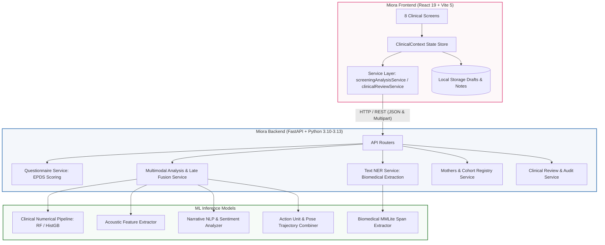
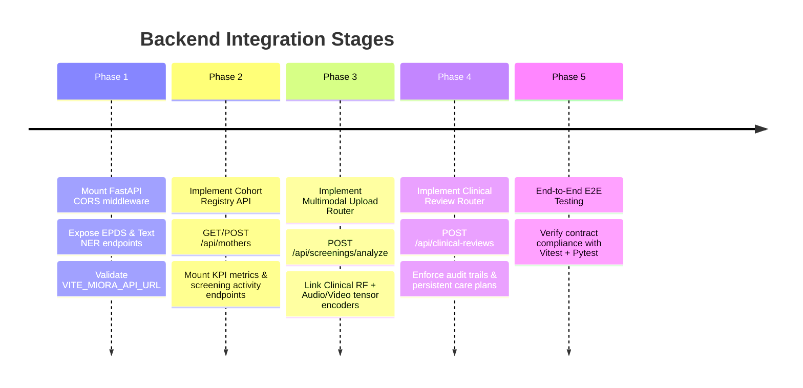

# Miora Frontend Architecture & Backend Integration Specification

**Document Version:** 1.0.0  
**Target Audience:** Full-Stack Engineers, Backend ML Engineers, Perinatal Informatics Architects  
**Scope:** Complete inventory of Miora frontend screens, state stores, services, and the full REST API specification required to replace mock data with the live FastAPI clinical backend.

---

## 1. System Architecture & Data Flow

Miora is a clinician-assisted multimodal screening platform for Postpartum Depression (PPD). The frontend is built as a single-page React 19 application running on Vite 5, providing 8 specialized clinical screens.



---

## 2. Frontend Screen Inventory & Route Map

| Screen ID | Page Component | Route Path | Description & Primary Function |
| :--- | :--- | :--- | :--- |
| **Landing** | `LandingPageRoute.jsx` | `/` | 3D Empathy Core visualization, clinical evidence, crisis helpline modal (988), portal access. |
| **Screen 01** | `CommandCenterPage.jsx` | `/dashboard` | Executive KPI cards, 4/8/12-week screening activity charts, cohort risk distribution, urgent alerts. |
| **Screen 02** | `MothersCasesPage.jsx` | `/mothers`, `/mothers/:motherId` | Cohort registry, pagination, search, risk/status filtering, "Add Mother" modal, Mother Profile Drawer. |
| **Screen 03** | `LiveScreeningPage.jsx` | `/live-screening` | Real-time conversational intake with camera/mic stream, live transcript, preliminary signal monitor. |
| **Screen 04** | `UploadAnalyzePage.jsx` | `/upload-analyze` | Multi-file uploader (Text, Audio, Video), validation, consent verification, and multimodal dispatch. |
| **Screen 05** | `ResultsPage.jsx` | `/results`, `/results/:motherId` | Overall risk score, EPDS equivalent, modality contributions, contributing factors, PDF export, handoff modal. |
| **Screen 06** | `DiscordancePage.jsx` | `/discordance`, `/discordance/:motherId` | Cross-modal divergence engine (e.g. calm text vs. acoustic strain), discrepancy severity, clinical guidance. |
| **Screen 07** | `InsightsCarePage.jsx` | `/insights`, `/insights/:motherId` | Longitudinal progress, care plan milestone tracker, customizable recommendations, care plan PDF generator. |
| **Screen 08** | `ClinicalReviewPage.jsx` | `/clinical-review`, `/clinical-review/:motherId` | Human-in-the-loop sign-off, AI score override, clinician notes, referral & intervention scheduling. |

---

## 3. Existing Backend Status & Endpoints

The repository backend currently implements two production-grade modules in `backend/`:

1. **EPDS Questionnaire Service (`backend/routers/questionnaire.py`)**:
   - `GET /api/questionnaire/epds`: Fetches verified 10-item Edinburgh Postnatal Depression Scale items.
   - `POST /api/questionnaire/epds/submit`: Validates responses, calculates 0–30 score, and enforces Question 10 self-harm safety protocol.
2. **Text Named Entity Recognition Service (`backend/routers/text_ner.py`)**:
   - `POST /api/text-ner/extract`: Biomedical entity span extraction (`MENTAL_HEALTH`, `SYMPTOM`, `TREATMENT`, `TEMPORAL`) from narrative text.

---

## 4. Required Backend API Endpoints for Full Integration

To eliminate client-side mock datasets (`mockClinicalData.js`) and complete end-to-end integration, the backend must expose the following REST endpoints:

### A. Cohort & Patient Registry API

#### 1. `GET /api/mothers`
Retrieves a paginated list of registered mothers with filtering and search.
- **Query Parameters:**
  - `page` (int, default: 1)
  - `limit` (int, default: 25)
  - `search` (string, optional: search by name or ID)
  - `risk` (string, optional: `'Low'`, `'Moderate'`, `'High'`, `'Requires Review'`)
  - `status` (string, optional: `'Active'`, `'Completed'`, `'Review'`, `'Follow-up'`, `'Pending'`)
  - `sort_by` (string, default: `'lastScreeningDate'`)
- **Response Shape (`200 OK`):**
```json
{
  "total": 328,
  "page": 1,
  "limit": 25,
  "items": [
    {
      "id": "M-104",
      "name": "Amara K.",
      "initials": "A. S.",
      "avatarInitials": "AS",
      "postpartumWeek": 6,
      "lastScreeningDate": "Apr 24, 2026",
      "lastScreeningIso": "2026-04-24T11:30:00Z",
      "status": "Review",
      "risk": "High",
      "reasonForReview": "Elevated distress cues",
      "priority": true,
      "discordanceFlag": true,
      "discordanceType": "Vocal tension vs. flat text affect",
      "epdsScore": 16,
      "lastScreeningTime": "1 hr ago",
      "voiceCueSummary": "Elevated pitch variability, prolonged pauses (2.4s avg), audible sighing.",
      "textCueSummary": "Expressed persistent exhaustion and feeling disconnected during evening feedings.",
      "carePlan": "Schedule urgent telehealth check-in within 24 hours; evaluate perinatal support network."
    }
  ]
}
```

#### 2. `POST /api/mothers`
Registers a new mother during intake.
- **Request Body:**
```json
{
  "name": "Sarah Jenkins",
  "postpartumWeek": 3,
  "reasonForReview": "Initial postpartum check-in",
  "risk": "Low"
}
```
- **Response Shape (`201 Created`):**
Returns the created mother record with auto-assigned `id` (e.g. `M-118`), formatted initials, and initial status (`'Pending'` or `'Review'`).

#### 3. `GET /api/mothers/{mother_id}`
Returns full medical and demographic details, current care plan, and historical screening summaries.

---

### B. Dashboard Metrics & Analytics API

#### 1. `GET /api/dashboard/metrics`
Powers the top KPI cards and distribution widgets on `/dashboard`.
- **Response Shape (`200 OK`):**
```json
{
  "registeredMothers": 328,
  "activeCases": 184,
  "screeningsCompleted": 251,
  "casesForReview": 38,
  "highRiskCases": 28,
  "potentialDiscordance": 19,
  "trends": {
    "registeredMothers": "+5%",
    "screeningsCompleted": "+8%",
    "casesForReview": "+12%",
    "potentialDiscordance": "+3%",
    "highRiskCases": "-3%"
  },
  "riskDistribution": [
    { "name": "Low Risk", "count": 145, "percentage": 58, "color": "#f5d3dc" },
    { "name": "Moderate Risk", "count": 51, "percentage": 20, "color": "#f5cbb8" },
    { "name": "High Risk", "count": 35, "percentage": 14, "color": "#ea8cab" },
    { "name": "Requires Review", "count": 20, "percentage": 8, "color": "#df487e" }
  ]
}
```

#### 2. `GET /api/dashboard/screening-activity`
Provides longitudinal volume data for the Recharts activity chart.
- **Query Parameters:** `timeframe` (`'4w'`, `'8w'`, `'12w'`)
- **Response Shape (`200 OK`):**
```json
[
  { "id": "wk-09", "week": "Week 1", "fullLabel": "4 Weeks Ago", "dateRange": "Oct 12 – Oct 18", "screenings": 33, "flagged": 4 },
  { "id": "wk-10", "week": "Week 2", "fullLabel": "3 Weeks Ago", "dateRange": "Oct 19 – Oct 25", "screenings": 46, "flagged": 6 },
  { "id": "wk-11", "week": "Week 3", "fullLabel": "2 Weeks Ago", "dateRange": "Oct 26 – Nov 1", "screenings": 55, "flagged": 5 },
  { "id": "wk-12", "week": "Week 4", "fullLabel": "Current Week", "dateRange": "Nov 2 – Nov 8", "screenings": 68, "flagged": 7 }
]
```

#### 3. `GET /api/dashboard/alerts`
Returns real-time clinical notifications (high risk flags, discordance warnings, incomplete screenings).

---

### C. Multimodal Screening & File Analysis API

This directly powers `src/dashboard/services/screeningAnalysisService.js` on `/upload-analyze`.

#### 1. `POST /api/screenings/analyze`
Accepts `multipart/form-data` with raw or pre-extracted multimodal inputs.
- **Form Data Fields:**
  - `motherId` (string, required): e.g. `"M-104"`
  - `modalities` (string, required): JSON stringified array, e.g. `'["text", "voice", "video"]'`
  - `consentConfirmed` (string, required): `"true"`
  - `files_text` (file, optional): Raw narrative text (`.txt`, `.json`)
  - `files_voice` (file, optional): Audio recording or acoustic features (`.wav`, `.mp3`, `.npy`)
  - `files_video` (file, optional): Video capture or OpenFace trajectory (`.mp4`, `.npy`)
- **Response Shape (`200 OK`):**
```json
{
  "combinedScore": 0.81,
  "riskCategory": "High Risk",
  "epdsEquivalent": 16,
  "discordanceDetected": true,
  "modalityContributions": {
    "text": 0.78,
    "voice": 0.85,
    "video": 0.79
  },
  "indicators": [
    "Persistent overwhelm and exhaustion cues detected in narrative text",
    "Elevated pitch variability and prolonged response latencies (>2.4s)",
    "Blunted facial expressiveness and reduced smiling during check-in"
  ],
  "discordanceAnalysis": {
    "discordanceScore": 0.74,
    "discordanceType": "Vocal tension vs. flat text affect",
    "severity": "High",
    "modalityRows": [
      { "key": "text", "label": "Text Reflection", "score": 0.78, "tone": "moderate" },
      { "key": "voice", "label": "Acoustic Tone", "score": 0.85, "tone": "high" },
      { "key": "video", "label": "Visual Dynamics", "score": 0.79, "tone": "high" }
    ],
    "guidance": "Clinician should explore latent stressors during 1-on-1 session."
  }
}
```

---

### D. Clinical Review & Assessment API

This directly powers `src/dashboard/services/clinicalReviewService.js` on `/clinical-review`.

#### 1. `POST /api/clinical-reviews`
Persists the final clinician assessment, overriding or verifying AI predictions.
- **Request Body (`Content-Type: application/json`):**
```json
{
  "motherId": "M-104",
  "screeningId": "SCR-244",
  "clinicianAssessment": {
    "reviewNotes": "Patient shows marked fatigue and signs of perinatal distress. Concur with AI risk score.",
    "clinicianRisk": "High",
    "decision": "Approve AI recommendation",
    "decisionReason": "Clinical presentation strongly matches elevated acoustic and self-report indicators."
  },
  "followUpPlan": {
    "nextScreening": "Within 48 hours",
    "careAction": "Perinatal specialist consult",
    "additionalSupport": "Partner / family involvement"
  },
  "reviewedBy": "Dr. Elena Rostova",
  "reviewedAt": "2026-11-13T16:30:00Z"
}
```
- **Response Shape (`200 OK`):**
```json
{
  "status": "success",
  "reviewId": "REV-2026-1104",
  "motherId": "M-104",
  "screeningId": "SCR-244",
  "persistedAt": "2026-11-13T16:30:05Z",
  "persistenceMode": "remote"
}
```

---

### E. Care Plans & Milestones API

Powers the care plan generator and PDF export on `/insights`.

#### 1. `GET /api/mothers/{mother_id}/care-plan`
Returns notes, milestone items, and selected recommendations.

#### 2. `PUT /api/mothers/{mother_id}/care-plan`
Updates milestones (`completed: true/false`), clinical notes, and custom action items.

#### 3. `POST /api/screenings/{screening_id}/handoff`
Logs secure referral / multi-disciplinary team handoff with consent audit trail.

---

## 5. Frontend Environment Configuration

To point the frontend to the backend service, set the following environment variable in `.env` (or `.env.local`):

```bash
# Backend REST API base URL
VITE_MIORA_API_URL=http://localhost:8000
```

When `VITE_MIORA_API_URL` is configured:
1. `screeningAnalysisService.js` routes uploads directly to `${VITE_MIORA_API_URL}/api/screenings/analyze`.
2. `clinicalReviewService.js` posts finalized reviews to `${VITE_MIORA_API_URL}/api/clinical-reviews`.
3. If the backend is unreachable or offline, the frontend safely alerts the clinician and offers local draft saving rather than crashing or inventing fabricated scores.

---

## 6. Implementation Roadmap for Backend Integration



