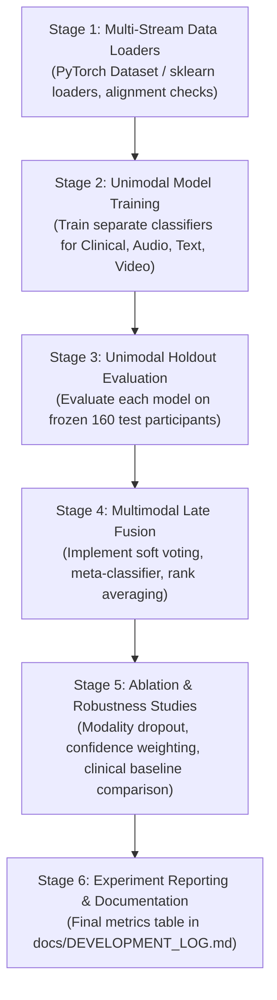

# Postpartum Depression (PPD) Multimodal Research Prototype: Developer Handoff Guide

**Document Version:** 1.0.0  
**Date:** November 8, 2026  
**Audience:** Incoming Machine Learning Engineer / Research Scientist  
**Scope:** Data foundations, modality specifications, loading protocols, and implementation roadmap for individual modality model development and multimodal late fusion.

---

## 1. Project Overview

This repository is an **Architectural Integration Benchmark and Engineering Prototype** for multimodal screening of Postpartum Depression (PPD). The prototype evaluates software integration, tensor pooling, contract adherence, and late fusion combining algorithms across four heterogeneous data streams:

1. **Clinical Numerical Branch:** 800 real de-identified survey records collected from postpartum mothers in Bangladesh, featuring 46 non-target clinical/demographic predictors and a canonical binary screening target ($\text{EPDS} \ge 13$).
2. **Synthetic Audio Branch:** 800 clinically conditioned synthetic acoustic profiles, providing 7 summary scalars and $(T_i, 128)$ abstract temporal embedding tensors.
3. **Synthetic Text Branch:** 800 fictional English postpartum contextual intake narratives (~120–147 words across 3 thematic paragraphs).
4. **Synthetic Video Branch:** 800 abstract 24-channel temporal feature trajectories ($(T_i, 24)$, $T_i \in [45, 120]$) capturing facial Action Units, head pose, gaze dynamics, and simulated tracking dropouts.

> [!IMPORTANT]
> **Scientific Modality Boundary:** The Bangladeshi clinical survey cohort contains **zero physical audio recordings, video sessions, or patient interview transcripts**. The audio, text, and video modalities are **synthetic engineering fixtures** computationally linked to participant IDs (`BGD_001` through `BGD_800`). They are designed to test multi-stream pipelines and late-fusion combiner architectures under controlled conditions. They do **not** represent authentic patient observations and cannot establish real-world clinical predictive efficacy.

---

## 2. Research Objective and Scope

- **Primary Objective:** Build, train, evaluate, and compare individual unimodal baseline classifiers and multimodal late fusion combiners for postpartum depression risk screening.
- **Completed Upstream Responsibility:** Data foundation establishment, numerical pipeline implementation, synthetic data generation across audio, text, and video branches, and cross-modality data consistency auditing.
- **Your Responsibility:**
  1. Construct robust data loaders and dataset classes.
  2. Implement, train, and cross-validate unimodal classifiers for each of the four branches.
  3. Evaluate each unimodal classifier on the frozen test set ($n=160$).
  4. Implement multimodal late fusioncombiners (e.g., weighted soft voting, meta-classification, rank averaging).
  5. Conduct modality ablation studies (e.g., Clinical alone vs. Clinical + Audio vs. All 4 modalities).
  6. Document experiment results and performance comparisons.

---

## 3. Current Implementation Status

| Component | Directory / Artifacts | Status | Description |
| :--- | :--- | :---: | :--- |
| **Clinical Numerical Pipeline** | `pipelines/clinical_numerical/` | **Complete** | Implements preprocessing, imputation, scaling, CV training, and baseline models (Random Forest primary, HistGradientBoosting, LogisticRegression). Training CV ROC-AUC = 0.8438, holdout test ROC-AUC = 0.8187. |
| **Synthetic Audio Generation** | `pipelines/synthetic_audio/` | **Complete** | Generates 800 profiles with 7 acoustic scalars and $(T, 128)$ temporal tensors in `data/synthetic/audio/`. |
| **Synthetic Text Generation** | `pipelines/synthetic_text/` | **Complete** | Generates 800 fictional intake narratives in `data/synthetic/text/narratives/`. |
| **Synthetic Video Generation** | `pipelines/synthetic_video/` | **Complete** | Generates 800 abstract 24-channel trajectories with 3–10% tracking dropout in `data/synthetic/video/features/`. |
| **Automated Test Suite** | `tests/` | **Complete** | **49 unit tests passed** (8 numerical, 12 audio, 14 text, 15 video). |
| **Unimodal Model Training** | Future | **Pending** | Your responsibility. |
| **Multimodal Late Fusion** | `fusion/` | **Pending** | Your responsibility. |

---

## 4. Repository Structure

```
d:\ppd-screening\
├── README.md                                  # Root project overview & handoff link
├── requirements.txt                           # Core dependencies
├── pytest.ini                                 # Pytest test paths and configuration
├── .gitignore                                 # Excludes raw, processed, and synthetic data
├── .env.example                               # Environment template
│
├── data/                                      # Data directories (Excluded from Git)
│   ├── raw/Numerical/                         # PPD_dataset_v3.csv (800 rows x 70 cols)
│   ├── processed/Numerical/                   # ppd_modeling_matrix.csv, train_test_split_manifest.csv
│   └── synthetic/                             # Generated synthetic modalities
│       ├── audio/                             # audio_manifest.csv & features/*.npy (T, 128)
│       ├── text/                              # text_manifest.csv & narratives/*.txt
│       └── video/                             # video_manifest.csv & features/*.npy (T, 24)
│
├── pipelines/                                 # Feature generation and modality pipelines
│   ├── clinical_numerical/                    # Numerical preprocessing, models, training
│   ├── synthetic_audio/                       # Audio generator, conditioning, config
│   ├── synthetic_text/                        # Text narrative generator, templates, config
│   └── synthetic_video/                       # Video feature trajectory generator, config
│
├── tests/                                     # Comprehensive automated test suite (49 tests)
│   ├── test_clinical_numerical.py             # 8 tests
│   ├── test_synthetic_audio.py                # 12 tests
│   ├── test_synthetic_text.py                 # 14 tests
│   └── test_synthetic_video.py                # 15 tests
│
├── fusion/                                    # Target directory for Multimodal Fusion (Next Stage)
├── evaluation/                                # Target directory for Evaluation & Metrics
├── backend/                                   # Target directory for FastAPI inference service
├── docs/                                      # Architecture, development logs, and handoff
│   ├── architecture.md                        # Complete system architecture specification
│   ├── DEVELOPMENT_LOG.md                     # Comprehensive phase-by-phase development log
│   └── TEAM_HANDOFF.md                        # This document
```

---

## 5. Dataset Locations and Schemas

### A. Clinical Numerical Data
- **Raw File:** `data/raw/Numerical/PPD_dataset_v3.csv` (800 rows $\times$ 70 columns). Contains raw survey questions and original scoring columns.
- **Processed Modeling Matrix:** `data/processed/Numerical/ppd_modeling_matrix.csv` (800 rows $\times$ 47 columns).
  - **Predictors (46 columns):** Demographics, marital status, obstetric history, household structure, infant care, and psychosocial support.
  - **Target (1 column):** `EPDS_high_risk_screening_threshold` (1 = high risk, 0 = low risk). Recomputed canonically from Edinburgh Postnatal Depression Scale items Q1–Q10 ($\ge 13$).
  - **Class Distribution:** Positive = 351 (43.88%), Negative = 449 (56.12%).
- **Split Manifest:** `data/processed/Numerical/train_test_split_manifest.csv` (800 rows $\times$ 5 columns).
  - Columns: `participant_id`, `sr`, `matrix_index`, `split_partition`, `target_canonical_epds_ge_13`.

### B. Synthetic Audio Data
- **Manifest:** `data/synthetic/audio/audio_manifest.csv` (800 rows $\times$ 13 columns).
  - Columns: `participant_id`, `split_partition`, `f0_mean_hz`, `f0_std_hz`, `jitter_local_percent`, `shimmer_local_percent`, `hnr_db`, `speech_rate_syllables_per_sec`, `pause_ratio`, `sequence_length`, `embedding_path`, `data_origin`, `generation_seed`.
  - Provenance: `data_origin = CLINICALLY_CONDITIONED_SYNTHETIC`.
- **Feature Tensors:** `data/synthetic/audio/features/BGD_xxx.npy` (800 files).
  - Shape: $(T_i, 128)$ where $T_i \in [30, 90]$ frames, dtype `np.float32`.

### C. Synthetic Text Data
- **Manifest:** `data/synthetic/text/text_manifest.csv` (800 rows $\times$ 12 columns).
  - Columns: `participant_id`, `split_partition`, `data_origin`, `generator_version`, `random_seed`, `narrative_file_path`, `word_count`, `character_count`, `sentence_count`, `language`, `conditioning_variables_used`, `missing_covariates_neutralized`.
  - Provenance: `data_origin = SYNTHETIC_FICTIONAL_NARRATIVE`.
- **Narratives:** `data/synthetic/text/narratives/BGD_xxx.txt` (800 files).
  - Format: Plain-text UTF-8, 3 paragraphs, exactly 9 sentences, length 120–147 words.

### D. Synthetic Video Data
- **Manifest:** `data/synthetic/video/video_manifest.csv` (800 rows $\times$ 11 columns).
  - Columns: `participant_id`, `split_partition`, `data_origin`, `generator_version`, `random_seed`, `feature_file_path`, `sequence_length`, `feature_dimension`, `dtype`, `missing_frame_count`, `mean_tracking_confidence`, `dropout_rate`.
  - Provenance: `data_origin = SYNTHETIC_ABSTRACT_VIDEO_FEATURES`.
- **Feature Tensors:** `data/synthetic/video/features/BGD_xxx.npy` (800 files).
  - Shape: $(T_i, 24)$ where $T_i \in [45, 120]$ frames, dtype `np.float32`.
  - Exact 24-channel order:
    - `0–13`: Action Units (`AU01_r`, `AU02_r`, `AU04_r`, `AU05_r`, `AU06_r`, `AU07_r`, `AU09_r`, `AU10_r`, `AU12_r`, `AU14_r`, `AU15_r`, `AU17_r`, `AU20_r`, `AU25_r`) in $[0.0, 5.0]$.
    - `14–16`: Head Pose (`pose_pitch`, `pose_yaw`, `pose_roll`) in $[-\pi/3, \pi/3]$ rad.
    - `17–19`: Gaze (`gaze_angle_x`, `gaze_angle_y` in $[-0.6, 0.6]$, `gaze_stability` in $[0.0, 1.0]$).
    - `20–21`: Motion Summaries (`rigid_motion`, `non_rigid_motion`) in $[0.0, 1.0]$.
    - `22–23`: Tracking Status (`tracking_confidence` in $[0.0, 1.0]$, `success_flag` in $\{0.0, 1.0\}$).
  - Simulated Dropout: 3% to 10% frames per participant with `confidence < 0.60` and `success_flag = 0.0`.

---

## 6. Participant IDs and Frozen Split

All four modalities are indexed to **identical participant IDs** `BGD_001` through `BGD_800`.
The train/test partition is permanently frozen in `data/processed/Numerical/train_test_split_manifest.csv`:

- **Training Partition (`split_partition == 'train'`):** Exactly **640 participants** (80.0%).
  - Positives: 281 | Negatives: 359 (Prevalence: 43.91%).
- **Testing Partition (`split_partition == 'test'`):** Exactly **160 participants** (20.0%).
  - Positives: 70 | Negatives: 90 (Prevalence: 43.75%).

> [!CAUTION]
> **Strict Partition Rules:**
> 1. NEVER regenerate the train/test split.
> 2. NEVER split each modality independently. All models must be evaluated on the exact same 160 holdout test participants.
> 3. Preprocessing (imputers, scalers, tokenizers, vocabulary counters) must be fitted **exclusively on the 640 training participants**. Never expose test records to preprocessing fitting.

---

## 7. How to Load Each Modality (Working Code Examples)

The following Python code snippets are verified against actual repository files and relative paths:

```python
import numpy as np
import pandas as pd
from pathlib import Path

# Set project root
PROJECT_ROOT = Path(__file__).resolve().parent if "__file__" in locals() else Path(".")

# 1. Load Frozen Split Manifest
split_df = pd.read_csv(PROJECT_ROOT / "data/processed/Numerical/train_test_split_manifest.csv")
train_ids = set(split_df[split_df["split_partition"] == "train"]["participant_id"])
test_ids = set(split_df[split_df["split_partition"] == "test"]["participant_id"])
print(f"Loaded split: {len(train_ids)} train, {len(test_ids)} test.")

# 2. Load Clinical Numerical Predictors & Target
matrix_df = pd.read_csv(PROJECT_ROOT / "data/processed/Numerical/ppd_modeling_matrix.csv")
target_col = "EPDS_high_risk_screening_threshold"
feature_cols = [c for c in matrix_df.columns if c != target_col]

X_clinical = matrix_df[feature_cols]
y_target = matrix_df[target_col]
print(f"Clinical Matrix: {X_clinical.shape[1]} predictors, target mean={y_target.mean():.4f}")

# 3. Load Synthetic Audio Manifest & Individual Tensor
audio_mf = pd.read_csv(PROJECT_ROOT / "data/synthetic/audio/audio_manifest.csv")
sample_audio_row = audio_mf.iloc[0]
audio_tensor = np.load(PROJECT_ROOT / sample_audio_row["embedding_path"])
print(f"Audio tensor {sample_audio_row['participant_id']}: shape={audio_tensor.shape}, dtype={audio_tensor.dtype}")

# 4. Load Synthetic Text Manifest & Individual Narrative
text_mf = pd.read_csv(PROJECT_ROOT / "data/synthetic/text/text_manifest.csv")
sample_text_row = text_mf.iloc[0]
with open(PROJECT_ROOT / sample_text_row["narrative_file_path"], "r", encoding="utf-8") as f:
    narrative_text = f.read()
print(f"Text narrative {sample_text_row['participant_id']}: {len(narrative_text.split())} words, 9 sentences.")

# 5. Load Synthetic Video Manifest & Individual Tensor
video_mf = pd.read_csv(PROJECT_ROOT / "data/synthetic/video/video_manifest.csv")
sample_video_row = video_mf.iloc[0]
video_tensor = np.load(PROJECT_ROOT / sample_video_row["feature_file_path"])
print(f"Video tensor {sample_video_row['participant_id']}: shape={video_tensor.shape}, dropout_rate={sample_video_row['dropout_rate']}")

# 6. Align All 4 Modalities on participant_id
multimodal_cohort = split_df[["participant_id", "split_partition", "target_canonical_epds_ge_13"]].copy()
multimodal_cohort = multimodal_cohort.merge(audio_mf[["participant_id", "embedding_path", "pause_ratio"]], on="participant_id")
multimodal_cohort = multimodal_cohort.merge(text_mf[["participant_id", "narrative_file_path", "word_count"]], on="participant_id")
multimodal_cohort = multimodal_cohort.merge(video_mf[["participant_id", "feature_file_path", "dropout_rate"]], on="participant_id")
assert len(multimodal_cohort) == 800
print("Multimodal cohort alignment successfully verified across 800 participants!")
```

---

## 8. Data Leakage and Scientific Restrictions

1. **Target Sequestration:** Under no circumstances should the target variable (`target_canonical_epds_ge_13` or `EPDS_high_risk_screening_threshold`) or any EPDS/PHQ questions enter feature extractors, preprocessors, or model inputs.
2. **Strictly Prohibited Features:**
   - Raw EPDS items (`EPDS_1` through `EPDS_10`)
   - EPDS summary scores or categorical risk bands
   - PHQ-9 items (`PHQ_1` through `PHQ_9`)
   - PHQ-2 depression history variables (`Depression before pregnancy (PHQ2)`, `Depression during pregnancy (PHQ2)`)
   - Trauma history (`Abuse`, `History of pregnancy loss`)
3. **No False Clinical Claims:**
   - Synthetic audio features must NOT be described as physical patient recordings.
   - Synthetic text narratives must NOT be described as authentic maternal interviews.
   - Synthetic video features must NOT be described as actual camera recordings, and Action Units must NOT be claimed as validated depression biomarkers.
4. **Missing Values:** In clinical numerical and text metadata, missing values must be imputed using neutral priors or explicitly modeled as missing indicator flags. Never convert missing values to negative responses ("No").

---

## 9. Environment Setup

Ensure you are working in Python 3.11+ (Python 3.13 supported).

```bash
# 1. Clone repository (code and documentation only)
git clone https://github.com/navamishetty72/ppd-screening.git
cd ppd-screening

# 2. Create virtual environment
python -m venv .venv

# 3. Activate virtual environment
# Windows PowerShell:
.venv\Scripts\Activate.ps1
# Linux / macOS:
source .venv/bin/activate

# 4. Install dependencies
pip install -r requirements.txt
```

---

## 10. How to Run Existing Tests

Verify that your local environment passes the full 49-test suite before modifying code:

```bash
# Run complete test suite quietly (use python -m pytest to avoid Windows execution policy restrictions)
python -m pytest -q

# Run with verbose test-level details
python -m pytest -v

# Run individual pipeline test suites
python -m pytest tests/test_clinical_numerical.py -v
python -m pytest tests/test_synthetic_audio.py -v
python -m pytest tests/test_synthetic_text.py -v
python -m pytest tests/test_synthetic_video.py -v
```

Expected output: **`49 passed in ~16s`**.

---

## 11. Next Developer's Implementation Roadmap



---

## 12. Model Training Responsibilities

You are responsible for designing and training unimodal baseline classifiers for each branch:

### Branch 1: Clinical Numerical Model
- **Status:** Baseline fully implemented, validated, and serialized under `pipelines/clinical_numerical/` and `models/clinical_numerical/`.
- **Primary Selected Model:** `random_forest` (`RandomForestClassifier`), selected strictly on training cross-validation:
  - 5-Fold CV ROC-AUC: **$0.8438 \pm 0.0457$** (highest among all evaluated models).
  - 5-Fold CV PR-AUC: **$0.8137 \pm 0.0531$**.
  - Holdout Test Generalization (Final Evaluation Estimate Only): ROC-AUC: **0.8187 [95% CI: 0.7518, 0.8820]**, PR-AUC: **0.8005 [95% CI: 0.7074, 0.8836]**, Accuracy: **76.25%**, Balanced Acc: **0.7635 [95% CI: 0.7000, 0.8294]**, Sensitivity: **77.14%**, F1: **0.7397 [95% CI: 0.6567, 0.8133]**, Brier Score: 0.1796.
- **Alternative Baselines:**
  - `hist_gradient_boosting` (CV ROC-AUC: $0.8297 \pm 0.0477$, Holdout Test ROC-AUC: 0.8310 [95% CI: 0.7700, 0.8920], Test Brier Score: 0.1725). Retained as an alternative nonlinear tree ensemble baseline. Note: holdout test metrics are reported strictly as final evaluation estimates and were not used for model selection; furthermore, while Brier score quantifies probabilistic accuracy, a lower Brier score alone does not prove probability calibration without dedicated calibration diagnostics.
  - `logistic_regression` (CV ROC-AUC: $0.8381 \pm 0.0487$, Holdout Test ROC-AUC: 0.8027 [95% CI: 0.7299, 0.8670]).
- **Exact Reproduction Command:**
  ```bash
  python -m pipelines.clinical_numerical.train
  ```
- **Saved Artifacts (`models/clinical_numerical/`):**
  - `random_forest.joblib` (Primary baseline), `hist_gradient_boosting.joblib` (Alternative baseline), `logistic_regression.joblib`
  - `preprocessor.joblib` (Fitted exclusively on 640 training participants, 151 encoded features)
  - `oof_predictions.csv` (Cross-validation out-of-fold probability predictions for 640 training participants — **use `random_forest_prob` as primary feature for stacking meta-classifiers**)
  - `test_predictions.csv` (Holdout predictions for 160 testing participants — **use `random_forest_prob` for primary late fusion evaluation**)
  - `metrics_summary.json` (Full 5-fold CV details and bootstrap 95% CIs)
- **Documentation:** See [`pipelines/clinical_numerical/README.md`](file:///d:/ppd-screening/pipelines/clinical_numerical/README.md) for full architecture and Python inference examples.
- **Task for Next Developer:** Maintain as the primary clinical comparison anchor ($\Delta \text{ROC-AUC} = \text{ROC-AUC}_{\text{fusion}} - 0.8187$); utilize `random_forest_prob` from `oof_predictions.csv` and `test_predictions.csv` for late fusion combining.

### Branch 2: Synthetic Audio Model
- **Input Options:**
  - Approach A: 7 summary acoustic scalars (`f0_mean_hz`, `pause_ratio`, etc.).
  - Approach B: Abstract temporal tensors of shape $(T_i, 128)$ passed through temporal pooling (mean/max pooling or 1D CNN / GRU).
- **Recommended Models:** Random Forest, LightGBM, or small 2-layer MLP on pooled embeddings.

### Branch 3: Synthetic Text Model
- **Input:** Raw fictional narratives from `data/synthetic/text/narratives/BGD_xxx.txt`.
- **Recommended Models:**
  - TF-IDF + Logistic Regression / LinearSVC.
  - Pretrained Transformer encoder (e.g. `distilbert-base-uncased` or `DeBERTa-v3-small`) fine-tuned for binary sequence classification.

### Branch 4: Synthetic Video Feature Model
- **Input:** 24-channel temporal feature trajectories of shape $(T_i, 24)$ from `data/synthetic/video/features/BGD_xxx.npy`.
- **Recommended Models:**
  - Global average & max pooling across time $\to$ Tabular Classifier.
  - Recurrent neural network (1-layer GRU or BiLSTM) with confidence masking (ignoring frames where `success_flag == 0`).
  - 1D Temporal Convolutional Network (TCN).

---

## 13. Multimodal Fusion Responsibilities

Implement multimodal fusion in the `fusion/` module after unimodal pipelines are validated:

1. **Late Probability Fusion (Soft Voting):**
   $$P_{\text{fusion}}(\hat{y}=1 \mid \mathbf{x}) = \sum_{m \in \mathcal{M}} w_m \cdot P_m(\hat{y}=1 \mid \mathbf{x}_m), \quad \sum w_m = 1$$
   - Baseline weights: Uniform ($w_m = 0.25$).
   - Optimized weights: Fit $w_m$ on out-of-fold training predictions using constrained optimization or logistic regression.
2. **Meta-Classification (Stacking):**
   - Train a meta-learner (e.g., Logistic Regression with L2 regularization) using the 5-fold cross-validation out-of-fold prediction probabilities from the 4 unimodal models.
3. **Defensive Missing-Modality Fallback:**
   - In real-world screening, audio or video may be unavailable.
   - Implement dynamic re-weighting when a modality fixture is degraded (e.g. video `mean_tracking_confidence < 0.60`) or absent.

---

## 14. Evaluation and Reporting Requirements

For every model and fusion combiner, report the following metrics on the **frozen 160 test records**:
1. **ROC-AUC** (with 95% bootstrap confidence interval, 1,000 iterations).
2. **Sensitivity (Recall)** at the optimal threshold ($\ge 0.50$ or Youden's $J$).
3. **Specificity** at the chosen threshold.
4. **F1-Score** and **Precision-Recall AUC (PR-AUC)**.
5. **Brier Score** (calibration measure).

### Required Ablation Comparison Table:
You must provide a comparative evaluation table contrasting:
- **Baseline:** Clinical Numerical Alone (The authentic clinical anchor).
- **Ablation 1:** Clinical + Audio.
- **Ablation 2:** Clinical + Text.
- **Ablation 3:** Clinical + Video.
- **Full Fusion:** Clinical + Audio + Text + Video.

---

## 15. Git and Dataset Transfer Instructions

### Crucial Git Boundary:
The repository `.gitignore` strictly excludes:
- `data/raw/*`
- `data/processed/*`
- `data/synthetic/*`

Cloning the GitHub repository **will not download the datasets**.

### Authorized Transfer Protocol:
1. Receive the compressed data archive `ppd_data_bundle.zip` through an authorized private channel.
2. Unpack into the project root so the directory structure matches:
   - `data/raw/Numerical/PPD_dataset_v3.csv`
   - `data/processed/Numerical/ppd_modeling_matrix.csv`
   - `data/processed/Numerical/train_test_split_manifest.csv`
   - `data/synthetic/audio/audio_manifest.csv` & `features/*.npy` (800 files)
   - `data/synthetic/text/text_manifest.csv` & `narratives/*.txt` (800 files)
   - `data/synthetic/video/video_manifest.csv` & `features/*.npy` (800 files)
3. **Never** remove data exclusions from `.gitignore` or push participant data to GitHub.

---

## 16. Reproducibility Checklist

Before publishing results or committing code, ensure:
- [ ] Random seed = 42 is explicitly set across NumPy, Python random, PyTorch/scikit-learn.
- [ ] No test participant records were used for scaling, imputation, or hyperparameter selection.
- [ ] All 49 existing data-generation tests pass (`python -m pytest -q`).
- [ ] New unit tests are added for unimodal models and fusion combiners.
- [ ] Results and model weights are logged in experiment logs, not source directories.

---

## 17. Known Limitations

1. **Synthetic Nature of Non-Clinical Modalities:** Audio, text, and video features are simulated fixtures. Any observed performance gain over the clinical numerical baseline measures architectural fusion capacity, **not real-world psychiatric predictive accuracy**.
2. **Cohort Demographics:** The clinical dataset represents mothers from specific rural/urban clinics in Bangladesh. Transferability to other populations or clinical settings has not been established.
3. **Single Timepoint Screening:** The clinical survey represents a single postpartum cross-section, not longitudinal monitoring.

---

## 18. Final Handoff Checklist

Before beginning development, the next engineer should execute:

```bash
# Step 1: Verify Python environment
python --version  # Must be >= 3.11

# Step 2: Verify dependencies
pip install -r requirements.txt

# Step 3: Verify datasets unpacked properly
python -c "
import pandas as pd
for path in [
    'data/processed/Numerical/train_test_split_manifest.csv',
    'data/synthetic/audio/audio_manifest.csv',
    'data/synthetic/text/text_manifest.csv',
    'data/synthetic/video/video_manifest.csv'
]:
    df = pd.read_csv(path)
    assert len(df) == 800, f'File {path} has {len(df)} rows, expected 800'
print('All 4 manifests verified with 800 records!')
"

# Step 4: Run existing test suite
python -m pytest -q
```
If all 4 manifests load with 800 records and `python -m pytest -q` returns **49 passed**, the repository is fully verified and ready for model development!

