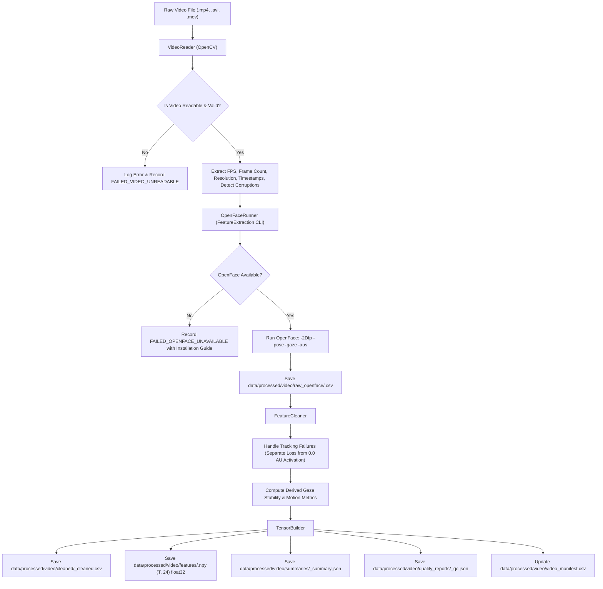

# Real Video Facial Feature Extraction Pipeline

**Pipeline Version:** 1.0.0  
**Project:** Postpartum Depression (PPD) Multimodal Recognition Research Prototype  
**Scope:** Ingestion, quality control, OpenFace 2.x extraction, cleaning, and tensor serialization for authentic video recordings.

---

## 1. Scientific Framework & Modality Boundaries

> [!IMPORTANT]
> **Modality Separation Notice:**
> - `pipelines/synthetic_video/`: Generates **abstract synthetic numerical feature trajectories** (AR(1) processes) exclusively for testing multi-stream software integration and late fusion combiner contracts.
> - `pipelines/real_video/` (This Pipeline): Processes **actual recorded video files** (.mp4, .avi, .mov) using OpenCV for video ingestion/QC and OpenFace 2.x for facial Action Unit, head pose, and eye gaze extraction.

### Core Scientific & Ethical Commitments:
1. **Zero Data Fabrication:** When OpenFace or video files are unavailable, the pipeline reports dependencies clearly and halts. It **never** substitutes random numbers or fake measurements.
2. **No Biomarker Claims:** Facial Action Units and head movements are **not** clinically validated diagnostic biomarkers for Postpartum Depression in this study.
3. **Strict Target Isolation:** Zero access to Edinburgh Postnatal Depression Scale (EPDS) items, total scores, PHQ-9 items, or canonical screening targets. Target leakage is guarded by automated assertions.
4. **Privacy & Data Governance:** Raw video files containing identifiable human faces are strictly excluded from Git version control via `.gitignore`. Participant identities are never logged in console outputs.

---

## 2. Architecture and Workflow



---

## 3. Exact Channel Schema (24 Channels per Frame)

The temporal feature tensor has shape $(T, 24)$ and dtype `float32`, structured into three distinct groups:

### Group A: OpenFace 2.x Direct Facial Action Units (Channels 0–13)
Continuous intensities in $[0.0, 5.0]$:
- **Ch 0:** `AU01_r` – Inner brow raiser
- **Ch 1:** `AU02_r` – Outer brow raiser
- **Ch 2:** `AU04_r` – Brow lowerer
- **Ch 3:** `AU05_r` – Upper lid raiser
- **Ch 4:** `AU06_r` – Cheek raiser
- **Ch 5:** `AU07_r` – Lid tightener
- **Ch 6:** `AU09_r` – Nose wrinkler
- **Ch 7:** `AU10_r` – Upper lip raiser
- **Ch 8:** `AU12_r` – Lip corner puller (zygomaticus)
- **Ch 9:** `AU14_r` – Dimpler
- **Ch 10:** `AU15_r` – Lip corner depressor
- **Ch 11:** `AU17_r` – Chin raiser
- **Ch 12:** `AU20_r` – Lip stretcher
- **Ch 13:** `AU25_r` – Lips part

### Group B: OpenFace 2.x Head Pose & Gaze (Channels 14–18)
- **Ch 14:** `pose_Rx` – 3D head pitch rotation in radians $[-\pi, \pi]$
- **Ch 15:** `pose_Ry` – 3D head yaw rotation in radians $[-\pi, \pi]$
- **Ch 16:** `pose_Rz` – 3D head roll rotation in radians $[-\pi, \pi]$
- **Ch 17:** `gaze_angle_x` – Eye gaze horizontal direction in radians $[-\pi/2, \pi/2]$
- **Ch 18:** `gaze_angle_y` – Eye gaze vertical direction in radians $[-\pi/2, \pi/2]$

### Group C: Derived Metrics & Tracking Quality (Channels 19–23)
*(Note: Channels 19–21 are custom derived metrics; Channels 22–23 are OpenFace tracking quality metrics)*
- **Ch 19:** `gaze_stability` – Derived gaze fixation stability scalar $[0.0, 1.0]$
- **Ch 20:** `rigid_motion` – Derived head rotation velocity summary $[0.0, 1.0]$
- **Ch 21:** `non_rigid_motion` – Derived Action Unit facial expression rate $[0.0, 1.0]$
- **Ch 22:** `confidence` – Frame-level face tracker confidence score $[0.0, 1.0]$
- **Ch 23:** `success` – Binary face detection indicator ($\{0.0, 1.0\}$; $0.0$ indicates tracking loss or occlusion)

---

## 4. Mathematical Definitions of Custom Derived Metrics

To maintain scientific rigor, custom metrics are explicitly distinguished from raw OpenFace outputs and defined as:

### 1. Gaze Stability ($\text{gaze\_stability}_t \in [0.0, 1.0]$)
Measures visual fixation consistency across adjacent video frames:
$$\Delta \theta_t = \sqrt{(\text{gaze\_angle\_x}_t - \text{gaze\_angle\_x}_{t-1})^2 + (\text{gaze\_angle\_y}_t - \text{gaze\_angle\_y}_{t-1})^2}$$
$$\omega_t = \frac{\Delta \theta_t}{\max(\Delta t_t, 10^{-4})} \quad (\text{angular velocity, rad/s})$$
$$\text{gaze\_stability}_t = \begin{cases} \exp\left(-\frac{\omega_t}{\omega_0}\right) & \text{if } \text{success}_t = 1 \\ 0.0 & \text{if } \text{success}_t = 0 \end{cases}$$
where $\omega_0 = 1.0\text{ rad/s}$ is a characteristic velocity constant. During stable fixation, $\omega_t \to 0 \implies \text{stability} \to 1.0$.

### 2. Rigid Head Motion ($\text{rigid\_motion}_t \in [0.0, 1.0]$)
Quantifies head angular displacement rate:
$$\Delta \mathbf{R}_t = \sqrt{(\Delta \text{pose\_Rx}_t)^2 + (\Delta \text{pose\_Ry}_t)^2 + (\Delta \text{pose\_Rz}_t)^2}$$
$$v_{\text{rigid}, t} = \frac{\Delta \mathbf{R}_t}{\max(\Delta t_t, 10^{-4})}$$
$$\text{rigid\_motion}_t = \begin{cases} \tanh\left(\frac{v_{\text{rigid}, t}}{v_0}\right) & \text{if } \text{success}_t = 1 \\ 0.0 & \text{if } \text{success}_t = 0 \end{cases}$$
where $v_0 = 1.0\text{ rad/s}$.

### 3. Non-Rigid Facial Motion ($\text{non\_rigid\_motion}_t \in [0.0, 1.0]$)
Quantifies facial expression change rate across all 14 Action Units:
$$\Delta \text{AU}_t = \frac{1}{14} \sum_{k=1}^{14} |\text{AU}_{k, t} - \text{AU}_{k, t-1}|$$
$$\text{non\_rigid\_motion}_t = \begin{cases} \tanh\left(\frac{\Delta \text{AU}_t / \Delta t_t}{\alpha_0}\right) & \text{if } \text{success}_t = 1 \\ 0.0 & \text{if } \text{success}_t = 0 \end{cases}$$
where $\alpha_0 = 1.0\text{ unit/s}$.

---

## 5. Tracking Failure Policy (No Zero-Imputation)

> [!CAUTION]
> **Crucial Facial Action Coding System (FACS) Principle:**
> In FACS, an Action Unit intensity of $0.0$ signifies a **completely relaxed, neutral facial muscle**.
> If face tracking is lost (e.g. participant looks down, turns away, or occlusion occurs), setting Action Units to $0.0$ introduces severe false diagnostic bias by erroneously recording a flat, emotionless affect!

### Preprocessing Protocol:
1. **Raw Cleaned Frame CSV:** Untracked frames (`success == 0` or `confidence < 0.60`) are explicitly marked with `is_valid_face = False`.
2. **Participant Summaries:** AU activation metrics (mean, std, 90th percentile) are computed **exclusively over valid tracked frames** (`is_valid_face == True`).
3. **Temporal Tensor Serialization:** To preserve sequence continuity for recurrent/pooling layers without false flat-affect shocks, continuous channels (0–21) forward-fill the last known facial state, while Channel 23 (`success = 0.0`) provides an explicit tracking indicator for downstream masking layers.

---

## 6. Generated Directory Structure

```
data/processed/video/
├── raw_openface/           # Exact, unmodified OpenFace FeatureExtraction CSV outputs
│   └── BGD_001_session1.csv
├── cleaned/                # Preprocessed frame-level CSVs with valid_face masks & derived metrics
│   └── BGD_001_session1_cleaned.csv
├── features/               # Temporal (T, 24) float32 NumPy arrays
│   └── BGD_001.npy
├── summaries/              # Participant-level summary JSONs (tracked-frame statistics)
│   └── BGD_001_summary.json
├── quality_reports/        # Individual QC JSON reports (readability, tracking rate, pass/fail)
│   └── BGD_001_qc.json
└── video_manifest.csv      # Master cohort manifest with processing status and provenance
```

---

## 7. Installation and Dependencies

### 1. Python Dependencies
Ensure `opencv-python`, `pandas`, `numpy`, and `pytest` are installed:
```bash
pip install opencv-python>=4.9.0 numpy>=1.26.0 pandas>=2.2.0 pytest>=8.0.0
```

### 2. OpenFace 2.x Setup
- **Windows:** Download precompiled binaries from [OpenFace Releases](https://github.com/TadasBaltrusaitis/OpenFace/releases) (e.g. OpenFace 2.2.0). Extract to `C:\OpenFace` and set:
  ```powershell
  $env:OPENFACE_BIN_PATH = "C:\OpenFace\FeatureExtraction.exe"
  ```
- **Linux:** Follow the [Unix Installation Guide](https://github.com/TadasBaltrusaitis/OpenFace/wiki/Unix-Installation) or run in Docker:
  ```bash
  docker pull algebr/openface:latest
  ```

---

## 8. Executable Commands

### Command 1: Check OpenFace & Environment Availability
```bash
python -m pipelines.real_video.pipeline check-openface
```

### Command 2: Process a Single Video
```bash
python -m pipelines.real_video.pipeline process-video \
  --video-path data/raw/video/sample.mp4 \
  --participant-id BGD_001 \
  --recording-id session1
```

### Command 3: Process an Entire Cohort
```bash
python -m pipelines.real_video.pipeline process-cohort \
  --raw-video-dir data/raw/video \
  --manifest data/raw/video/video_cohort_manifest.csv
```

### Command 4: Run Feature Validation Suite
```bash
python -m pytest tests/test_real_video.py -v
```

### Command 5: Generate Processing Quality Report
```bash
python -m pipelines.real_video.pipeline generate-report
```

